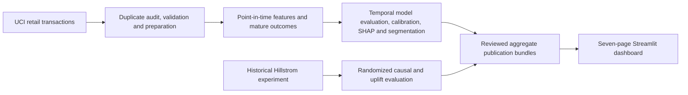

# Commercial Retention Analytics

**A practical analytics and decision-support project for understanding repeat purchasing, prioritising CRM attention, estimating customer value, and measuring campaign effects responsibly.**

[](https://commercial-retention-analysis.streamlit.app) [](https://github.com/SanSynyster/commercial-retention-analysis/actions/workflows/tests.yml)

**Live dashboard:** [commercial-retention-analysis.streamlit.app](https://commercial-retention-analysis.streamlit.app)

Python 3.11 · pandas · scikit-learn · XGBoost · LightGBM · SHAP · Streamlit · GitHub Actions

## The commercial problem

Retention teams need to decide where analysis can help and where evidence is not strong enough to support an intervention. This project works through five practical questions:

- Which customers are likely to make another purchase within a defined window?
- Which customers might a CRM team prioritise under a fixed contact capacity?
- What qualifying merchandise value and purchase timing might be observed over a future horizon?
- How can campaign impact be measured with a randomized control group?
- How do we keep a likely purchase separate from an incremental response caused by contact?

The retail analysis uses corrected historical UCI Online Retail II transactions from 2009–2011. A separate historical randomized email experiment supplies causal evidence. Neither dataset represents a current CRM customer base.

## Live application

The [Streamlit dashboard](https://commercial-retention-analysis.streamlit.app) presents seven aggregate-only pages. It reads reviewed JSON bundles committed in `app_data/`; it does not train models at startup, score live customers, or execute campaigns.

| Page | What it covers |
|---|---|
| **Customer Overview** | Corrected purchase activity, mature 90-day repeat outcomes, customer concentration, first-observed cohorts, and descriptive frequency/recency groups. |
| **Purchase Propensity** | Historical M1 new-customer and M2 established-customer prediction results, with exploratory calibration context. These are separate prediction tasks. |
| **Predictive Intelligence** | Aggregate P3 model comparisons, Random Forest SHAP summaries, temporal stability, and calibration diagnostics. |
| **Segmentation Intelligence** | Historical RFM profiles and supplementary exploratory three-cluster K-Means results, with subsequent observed purchasing outcomes. |
| **Causal Evidence & Experimentation** | Hillstrom randomized assignment results, clearly separated from exploratory development uplift comparisons. |
| **CRM Targeting Explorer** | Retrospective purchase capture for ranking policies at evaluated 5%, 10%, and 20% capacities. |
| **CRM Experiment Feasibility** | A hypothetical randomized-pilot calculator for enrollment, allocation, minimum detectable effect, and scenario economics. |

The application is prepared for Streamlit Community Cloud. See the [app guide](app/README.md) for its page-level scope, evidence labels, runtime, bundle provenance, and deployment settings.

### Screenshots

Dashboard screenshots will be added in a future documentation update.

## Analytics and modelling

| Workstream | Purpose and evaluation | Verified finding |
|---|---|---|
| **Data preparation and QA** | Reconciled UCI Online Retail and Online Retail II, audited repeated records, validated product taxonomy, purchase occasions, monetary totals, and follow-up maturity. | Removed only the reviewed **22,523-row overlap block**; other repeated rows were retained. Corrected-V2 analysis reports **5,852 identifiable qualifying customers**, **36,594 customer–invoice occasions**, and **£17.124m identified qualifying gross merchandise**. This gross merchandise measure is not accounting revenue, margin, or profit. |
| **Repeat-purchase propensity** | Point-in-time monthly established-customer snapshots predict at least one qualifying purchase in the next 30 days from the preceding 365 days. Development evaluation uses four temporal origins (March–June 2011) and mature labels. | On **17,221 development snapshots** from **4,670 customers** (18.95% positive), Random Forest achieved ROC-AUC **0.7824** and average precision **0.5395**, versus frozen regularised logistic regression (Logistic C) at **0.7752 / 0.5291**. This is a modest historical ranking advantage, conditional on the evaluated folds. |
| **Model selection** | Logistic C and frequency ranking were benchmarked with Random Forest and HistGradientBoosting; bounded XGBoost and LightGBM extensions used the same temporal protocol. | XGBoost and LightGBM did not meet the predefined development adoption criteria over Random Forest. The reviewed conclusion retains Random Forest as a **development reference**, not a prospectively validated production model. |
| **Calibration** | Calibration intercept/slope, Brier score, and log loss assess whether predicted probabilities agree with observed rates. Calibration experiments are distinct from ranking performance. | On the previously examined July–November holdout, purchase prevalence was **23.50%**, while model mean predictions were around **17.5%**. This historical prevalence shift and underprediction make probability use uncertain; no selected recalibration map is presented as ready for operational decisions. |
| **Explainability** | SHAP attributes Random Forest predictions across 4,000 sampled development explanations; stability is compared across the four development origins. | 365-day purchase-date and purchase-occasion counts were the strongest average attributions. Correlated features can share attribution; SHAP explains model predictions and is not causal importance. |
| **Customer value** | 30-day amount prediction is primary, assessed over four temporal development origins; 60-day results are secondary and more limited. Measures include MAE, RMSE, Tweedie deviance, and top-decile spend capture. | For 30-day gross merchandise, HistGradientBoosting MAE was **£128.61** versus **£119.49** for predicting zero; historical rate had the lowest RMSE (**£541.69**) versus HGB’s **£560.49**. No approach wins across all metrics. Outcomes are highly skewed and are not net revenue or profit. |
| **Purchase timing / survival** | Kaplan–Meier and ridge Cox models estimate time to next qualifying purchase, treating non-purchases and incomplete observation as censored. | In the four March–June development folds, Cox 30-day-truncated Harrell C ranged **0.738–0.765**, compared with **0.500** for the population Kaplan–Meier ranking baseline. The short, repeated historical windows do not establish future performance or the effect of contacting customers. |
| **Segmentation** | RFM is the primary descriptive grouping; a three-cluster K-Means solution is supplementary. March 2011 groups are compared with April–June observed purchase behaviour. | K-Means silhouette was **0.384** and mean seed ARI **0.993**. The reviewed evidence does not demonstrate meaningful incremental purchase discrimination beyond RFM. Segment outcome rates are retrospective, not calibrated probabilities or treatment effects. |
| **Randomized causal inference** | A separate historical Hillstrom three-arm email experiment evaluates assignment effects on a locked test split; secondary outcomes receive multiplicity adjustment. | Men's-email assignment increased two-week website visits by **8.163 percentage points** versus no email (95% Newcombe interval **6.667 to 9.658 pp**; **4,262 vs 4,261** test assignments). Conversion and spend contrasts were inconclusive after adjustment. This is an effect in the historical experiment, not an effect estimate for UCI customers or current campaigns. |
| **Uplift modelling** | Candidate CATE and policy rankings are compared on Hillstrom development data; test evaluation is reserved for the selected policy. | No personalized learner passed the prespecified development promotion rule. On the locked test, the selected constant-effect policy corresponds to random allocation within a 20% budget; it does not show that personalization improves value. |
| **CRM targeting and experiment feasibility** | Historical purchase capture is measured at fixed contact capacities. A separate calculator illustrates assumptions for a future randomized pilot. | Propensity policies capture historical purchasers; they do not estimate incremental response. The feasibility page uses user-entered hypothetical values and estimates neither campaign effect nor observed savings, ROI, or profit. |

### How to read these results

The main propensity comparison is **development evidence** from temporal folds. July–November 2011 results reused in some reports are a **previously examined historical holdout**, labelled exploratory rather than untouched confirmation. Hillstrom’s locked-test visit result is **randomized experimental evidence** for that historical assignment and outcome. Development uplift-policy comparisons are not confirmatory test findings. None of these evaluations establishes prospective model generalisation or current campaign economics.

## Architecture



The application consumes aggregate bundles rather than customer-level modelling outputs. The repository includes research code and documentation for data validation, feature engineering, benchmarking, evaluation, and bundle validation. This architecture does not include a live scoring service, production customer database, or real-time CRM integration.

## Run locally

### Run the dashboard

Python **3.11** is the application runtime (`.python-version`). From the repository root:

```sh
python3.11 -m venv .venv
.venv/bin/python -m pip install -r requirements-app.txt
.venv/bin/streamlit run app/streamlit_app.py
```

`requirements-app.txt` contains the application runtime dependencies. The app reads the committed aggregate bundles and can run without raw source datasets or network/database access.

### Run tests

Install the CI dependency set for the full suite:

```sh
python3.11 -m venv .venv-research
.venv-research/bin/python -m pip install -r requirements-ci.txt
.venv-research/bin/python -m unittest discover -s tests
```

The verified clean-environment run completed **276 tests with 11 expected skips**.

The CI workflow at [`.github/workflows/tests.yml`](.github/workflows/tests.yml) runs the repository's CI-safe validation using `requirements-ci.txt` and `make validate-ci PYTHON=python`. The focused application test command and notes about source-dependent skips are in [`app/README.md`](app/README.md#tests). Some rebuild tests require private/source aggregates and skip when those inputs are unavailable.

### Source data and aggregate bundles

Raw UCI transaction files and Hillstrom row-level data are not distributed in this repository. UCI source datasets are attributed under **CC BY 4.0**; see [data provenance and attribution](docs/DATA_PROVENANCE.md) for citations, integrity pins, and the corrected-V2 transformation. Obtain the exact pinned source files separately and verify their hashes before rebuilding source-dependent analyses. A different Online Retail II conversion may not reproduce the pinned input.

Hillstrom’s original challenge data is attributed to MineThatData. The source CSV and row-level assignments/predictions are excluded; the app contains reviewed aggregate findings only. The source-data publication assessment records that dataset redistribution permission was not established. Do not infer a dataset licence from a software package that can download it.

Do not run aggregate rebuilds as part of a routine app launch. For the corrected-V2 report reproduction and its source requirements, see the [corrected-V2 reproduction guide](reports/corrected_v2/README.md). For app bundle provenance and supported rebuild commands, see [`app/README.md`](app/README.md).

## Repository guide

| Path | Contents |
|---|---|
| `app/`, `app_data/` | Seven-page Streamlit application and committed aggregate-safe bundles. |
| `src/` | Data preparation, feature, modelling, evaluation, feasibility, and bundle modules. |
| `tests/` | Application, bundle, analytics, and research validation tests. |
| `docs/research/` | Phase 2/3 evaluation protocols, results, reviews, and integration notes. |
| `reports/` | Stakeholder summaries and corrected-V2 aggregate report. |
| `docs/` | Reproducibility, data provenance, technical documentation, and navigation. |
| `notebooks/`, `sql/`, `dbt/`, `databricks/` | Exploratory analysis and supporting engineering work; not all are part of the corrected-V2 findings. |

Start with the [documentation index](docs/index.md), [reproducibility guide](docs/REPRODUCIBILITY.md), [data provenance](docs/DATA_PROVENANCE.md), and [technical skills matrix](docs/technical_skills_matrix.md). Deeper Phase 3 sources: [propensity benchmark](docs/research/COMMERCIAL_DS_P3_002_ADVANCED_ML_BENCHMARK.md), [XGBoost/LightGBM comparison](docs/research/COMMERCIAL_DS_P3_003_XGBOOST_LIGHTGBM_BENCHMARK.md), [SHAP](docs/research/COMMERCIAL_DS_P3_004_SHAP_EXPLAINABILITY.md), [calibration](docs/research/COMMERCIAL_DS_P3_005_CALIBRATION_UNCERTAINTY.md), [value and timing](docs/research/COMMERCIAL_DS_P3_006_FUTURE_VALUE_AND_PURCHASE_TIMING.md), [segmentation](docs/research/COMMERCIAL_DS_P3_007_ADVANCED_SEGMENTATION.md), and [causal synthesis](docs/research/COMMERCIAL_DS_P3_008D_CAUSAL_RESEARCH_SYNTHESIS.md).

## Licences and attribution

Project code is MIT-licensed; see [`LICENSE`](LICENSE). The software licence does not grant rights to third-party source datasets. UCI attribution and CC BY 4.0 terms are documented in [`docs/DATA_PROVENANCE.md`](docs/DATA_PROVENANCE.md). Hillstrom source data is not redistributed. Dataset sources retain their own terms.

---

**Suggested GitHub repository description:** `End-to-end customer retention analytics: data quality, propensity and value models, segmentation, causal evaluation, and a Streamlit decision-support dashboard.`

**Suggested topics:** `data-science`, `customer-analytics`, `customer-retention`, `machine-learning`, `causal-inference`, `streamlit`, `python`, `explainable-ai`, `customer-segmentation`
