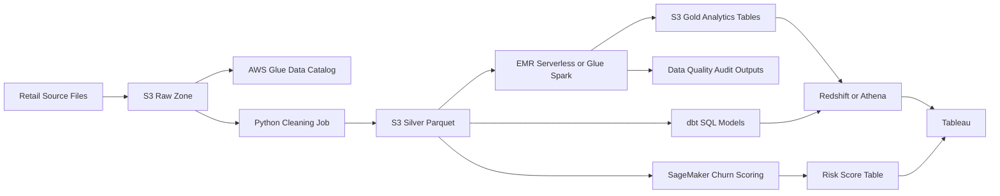
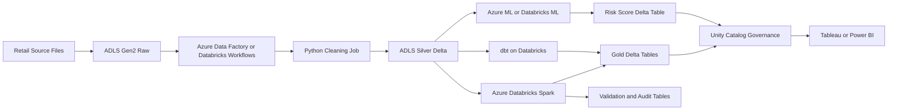
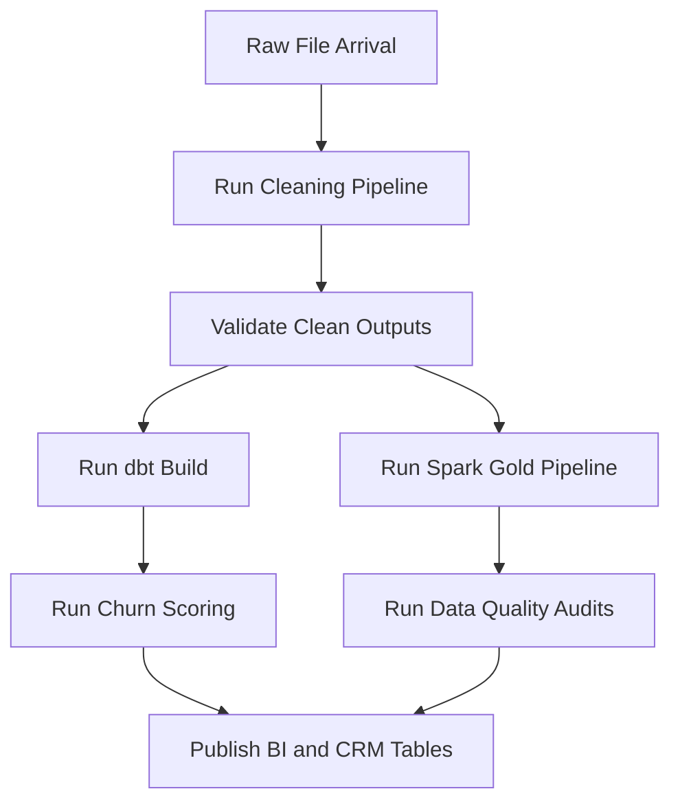

# Cloud Architecture

## Purpose

This document maps the local retention analytics platform to production-style AWS and Azure architectures. The repository can be reviewed and tested locally, while these designs show how the same assets would scale into governed cloud analytics platforms.

No cloud account is required to use this document. Azure or AWS accounts are only needed when deploying the architecture.

## Local To Cloud Mapping

| Local Asset | Production Role | AWS Option | Azure Option |
| --- | --- | --- | --- |
| `data/raw/` | Raw source landing zone | Amazon S3 raw bucket | ADLS Gen2 raw container |
| `src/run_pipeline.py` | Batch cleaning pipeline | AWS Glue Python Shell, ECS, or MWAA task | Azure Databricks job or Azure Container Apps |
| `data/processed/*/clean_transactions.parquet` | Silver transaction layer | S3 silver parquet/Iceberg table | ADLS Gen2 silver Delta table |
| `dbt/models` | SQL transformation layer | dbt on Redshift/Athena | dbt on Databricks/Synapse |
| `src/spark_pipeline.py` | Scalable Spark gold marts | EMR Serverless or AWS Glue Spark | Azure Databricks |
| `src/churn_prediction.py` | ML feature/training/scoring layer | SageMaker or EMR/Spark job | Azure ML or Databricks ML |
| `databricks/` | Databricks job deployment | Databricks on AWS optional | Azure Databricks Asset Bundle |
| `dashboards/` and docs | BI consumption | Tableau on Redshift/Athena | Tableau or Power BI on Databricks/Synapse |

## AWS Target Architecture

### AWS Service Design

| Layer | AWS Service | Notes |
| --- | --- | --- |
| Storage | S3 | Separate raw, silver, gold, and audit prefixes or buckets |
| Catalog | AWS Glue Data Catalog | Registers parquet/Iceberg/Delta-compatible metadata |
| Python pipeline | AWS Glue Python Shell, ECS Fargate, or MWAA task | Runs cleaning and validation pipeline |
| Spark | EMR Serverless or AWS Glue Spark | Runs `src/spark_pipeline.py` logic at scale |
| SQL/dbt | Redshift, Athena, or dbt Cloud | Runs marts and tests depending on warehouse choice |
| ML | SageMaker Processing/Training or Batch Transform | Trains and scores lapse-risk model |
| Orchestration | MWAA, Step Functions, or EventBridge | Schedules cleaning, dbt, Spark, ML, and audit tasks |
| BI | Tableau | Connects to Redshift, Athena, or published extracts |

### AWS Data Flow

1. Raw retail files land in `s3://.../raw/online-retail/`.
2. A cleaning job standardizes schema, applies revenue flags, and writes silver parquet.
3. dbt builds SQL marts for customer metrics, cohorts, churn/CLV, and experimentation.
4. Spark builds scalable gold marts and writes audit outputs.
5. Churn scoring writes latest risk scores for CRM prioritization.
6. Tableau consumes curated warehouse tables and score outputs.

### AWS Governance Notes

- Use IAM roles scoped by layer: raw read/write, silver transform, gold publish, BI read-only.
- Store secrets in AWS Secrets Manager or dbt Cloud environment variables.
- Use Glue catalog table permissions or Lake Formation if fine-grained governance is required.
- Partition silver/gold tables by processing date or source period when data volume grows.

## Azure Target Architecture

### Azure Service Design

| Layer | Azure Service | Notes |
| --- | --- | --- |
| Storage | ADLS Gen2 | Raw, silver, gold, and audit containers or folders |
| Compute | Azure Databricks | Runs Spark gold pipeline and optional Python cleaning jobs |
| Deployment | Databricks Asset Bundles | Uses `databricks/` bundle in this repo |
| Governance | Unity Catalog | Catalogs silver/gold Delta tables and controls access |
| SQL/dbt | dbt on Databricks or Azure Synapse | Runs tested SQL marts |
| ML | Azure ML or Databricks ML | Tracks churn models and score outputs |
| Orchestration | Databricks Workflows or Azure Data Factory | Schedules pipelines and dependencies |
| BI | Tableau or Power BI | Consumes gold Delta tables through Databricks SQL or semantic layer |

### Azure Data Flow

1. Raw files land in ADLS Gen2 raw storage.
2. Cleaning pipeline writes silver clean transactions as Delta or parquet.
3. Databricks Asset Bundle deploys `commercial_retention_spark_gold_build`.
4. Shared Spark logic writes gold customer, cohort, and concentration tables.
5. dbt builds and tests SQL marts on Databricks or DuckDB locally.
6. Churn scoring writes risk scores for CRM activation and BI.
7. Unity Catalog governs table access and lineage.

### Azure Account Timing

You do not need Azure for local development or repository review.

Create an Azure account when you are ready to:

- Provision Azure Databricks.
- Create ADLS Gen2 storage.
- Configure Unity Catalog or a workspace metastore.
- Authenticate the Databricks CLI.
- Deploy and run the Asset Bundle.
- Connect Tableau or Power BI to Databricks SQL.

## Orchestration Pattern

Recommended production task order:

1. Land raw data.
2. Run cleaning and validation.
3. Build dbt marts and tests.
4. Build Spark gold marts.
5. Train or score churn model on schedule.
6. Publish CRM priority and BI-ready outputs.
7. Alert on failed reconciliation or data quality checks.

## Deployment Readiness Checklist

| Area | Current Repo Status | Production Step |
| --- | --- | --- |
| Cleaning pipeline | Implemented locally | Containerize or schedule in cloud |
| dbt marts/tests | Implemented with DuckDB | Point profiles to warehouse or Databricks |
| Spark gold pipeline | Implemented locally | Run on EMR/Glue/Databricks |
| Databricks bundle | Scaffolded | Authenticate CLI and deploy to workspace |
| Churn model | Productionized locally | Add model registry and scheduled scoring |
| BI assets | Documented | Connect Tableau/Power BI to gold marts |
| Monitoring | Validation checks exist | Add alerting and run history retention |
