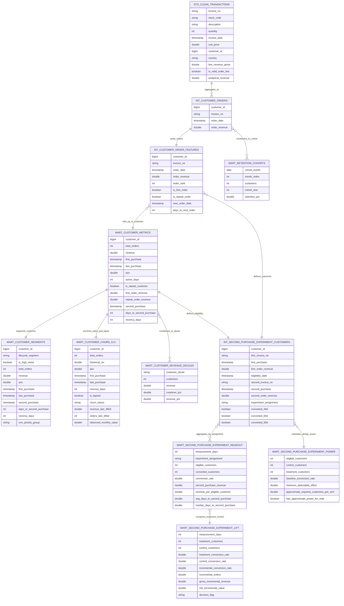

# Database Schema

## Purpose

This document shows the analytical warehouse model used by the dbt layer. It is a logical ERD for reviewer understanding rather than a physical OLTP schema. The model is optimized for retention analytics, product analytics, experimentation, churn/CLV analysis, and BI consumption.

## Model Grain

| Model | Grain | Primary Key Or Natural Key |
| --- | --- | --- |
| `stg_clean_transactions` | Transaction line | `invoice_no`, `stock_code`, `invoice_date`, line-level source fields |
| `int_customer_orders` | Customer invoice | `customer_id`, `invoice_no` |
| `int_customer_order_features` | Customer invoice | `customer_id`, `invoice_no` |
| `mart_customer_metrics` | Customer | `customer_id` |
| `mart_customer_segments` | Customer | `customer_id` |
| `mart_customer_churn_clv` | Customer | `customer_id` |
| `mart_retention_cohorts` | Cohort month x month index | `cohort_month`, `month_index` |
| `mart_customer_revenue_deciles` | Customer decile | `customer_decile` |
| `int_second_purchase_experiment_customers` | Customer | `customer_id` |
| `mart_second_purchase_experiment_readout` | Measurement window x assignment | `measurement_days`, `experiment_assignment` |
| `mart_second_purchase_experiment_lift` | Measurement window | `measurement_days` |
| `mart_second_purchase_experiment_power` | Experiment design summary | Single-row design summary |

## ERD

## Design Notes

- Customer-level analytics are scoped to identifiable customers with valid positive purchase lines.
- `int_customer_orders` is the core fact table for lifecycle and retention logic.
- `mart_customer_metrics` is the main customer dimension-like mart for BI, segmentation, churn/CLV, and experimentation.
- Experiment marts separate customer-level eligibility/outcomes from aggregate readout and treatment-control lift.
- Revenue reconciliation is tested through dbt singular tests to keep transaction, order, and customer grains aligned.
