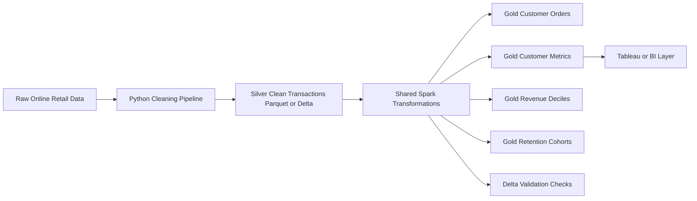

# Databricks Support

## Purpose

The Databricks layer packages the Spark retention mart pipeline for cloud execution while reusing the same transformation logic as the local PySpark path. It is implemented with Databricks Asset Bundles so the project shows production-style deployment rather than ad hoc notebook execution.

You do not need an Azure account yet to continue local development. You need Azure when you are ready to create a real Azure Databricks workspace, configure cloud storage, authenticate the Databricks CLI, deploy the bundle, and run the job.

## Architecture



## Repository Assets

| Asset | Purpose |
| --- | --- |
| `src/spark_pipeline.py` | Shared Spark transformations and Delta write support |
| `src/run_databricks_pipeline.py` | CLI entrypoint for Databricks-style Delta execution |
| `databricks/databricks.yml` | Databricks Asset Bundle definition |
| `databricks/resources/jobs.yml` | Job and cluster configuration |
| `databricks/notebooks/run_gold_pipeline.py` | Databricks task wrapper that imports shared source code |
| `databricks/README.md` | Bundle usage commands |

## Local To Databricks Mapping

| Local Layer | Databricks Layer | Table |
| --- | --- | --- |
| `clean_transactions.parquet` | Silver | `silver_clean_transactions` or cloud parquet path |
| `spark/customer_orders.parquet` | Gold | `gold_customer_orders` |
| `spark/customer_metrics.parquet` | Gold | `gold_customer_metrics` |
| `spark/customer_revenue_deciles.csv/` | Gold | `gold_customer_revenue_deciles` |
| `spark/retention_cohorts.csv/` | Gold | `gold_retention_cohorts` |
| `spark_parity_summary.csv` | Audit | Databricks validation output |

## Bundle Workflow

From the `databricks/` directory:

```bash
databricks bundle validate -t dev
databricks bundle deploy -t dev
databricks bundle run commercial_retention_spark_gold_build -t dev
```

Bundle variables can be overridden at deploy/run time:

```bash
databricks bundle run commercial_retention_spark_gold_build -t dev \
  --var="catalog=main" \
  --var="target_schema=commercial_retention_gold" \
  --var="clean_transactions_path=abfss://container@storageaccount.dfs.core.windows.net/retention/silver/clean_transactions"
```

## Azure Account Timing

Create an Azure account only when you want to execute this in a real cloud workspace. Local repository development can continue without Azure.

You will need Azure for:

- Azure Databricks workspace creation.
- ADLS Gen2 storage account and container setup.
- Unity Catalog or workspace metastore configuration.
- Databricks CLI authentication.
- Running the Asset Bundle job on a Databricks cluster.

You do not need Azure for:

- Python pipeline development.
- dbt DuckDB development.
- local Spark code review.
- unit tests.
- documentation and portfolio review.

## Validation

The Databricks job validates:

- Customer count is positive.
- Customer revenue is positive.
- Gold customer IDs are non-null.
- Retention percentages are between 0 and 1.

These checks are intentionally simple and job-native so they can fail the Databricks task if a gold mart is unusable.
