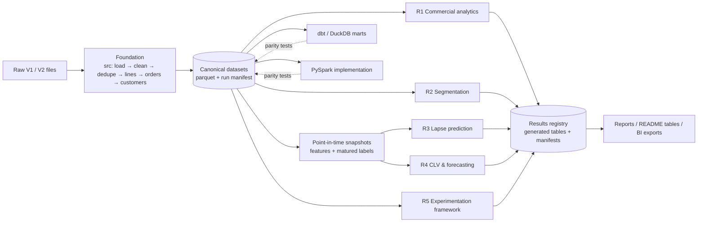

# COMMERCIAL-DS-001 — Executive Blueprint

Part of the [recovery index](README.md). This blueprint is grounded in the approved [decision log](COMMERCIAL_DS_001_DECISION_LOG.md) and the public [research status](../../docs/RESEARCH_STATUS.md).

## 1. Mission

**Commercial Data Science & Customer Intelligence.** The goal is a reproducible, evidence-driven commercial analytics and applied-ML research project. It investigates customer behaviour, retention, purchasing patterns, revenue forecasting and marketing decision-making for an online retailer. All studies share **one** canonical data foundation and **one** set of business definitions.

The project is a **staged research programme**, not a production system. Its credibility depends on:

1. every reported number being regenerated by code from a recorded run;
2. every model being compared against a simple baseline;
3. negative findings being reported as negative;
4. simulated, assumed and observed evidence never being mixed.

## 2. Assessment of the direction

| Aspect | Assessment |
| --- | --- |
| Multi-study framing | **Sound.** It matches the real scope of commercial data science better than a single churn model, and it reuses the verified foundation. |
| Dataset fit | **Adequate with hard limits.** The data covers 25 months (V2) of B2B-leaning transactions from a UK gift wholesaler. It has no marketing exposure, cost/margin, channel, demographic or product-hierarchy data. |
| Biggest scientific risk | Treating V1 as a customer-acquisition dataset. V1 is heavily left-censored: 62.8% of its customers bought before V1 starts. |
| Biggest engineering risk | Duplicated logic across notebooks, `src/`, `sql/`, dbt and Spark, which has already diverged. Consolidation must come before new research. |
| Biggest research risk | Over-claiming: experiment "lift" from untreated customers, a "directionally useful" model at AUC 0.52, and Spark/Databricks presented as deployed. |

**Verdict:** proceed, but only after Phase 2 (data contracts) and Phase 3 (consolidation) are complete and reviewed.

## 3. Scope

### In scope
- Six connected workstreams (R1–R6), specified in the [research programme](COMMERCIAL_DS_001_RESEARCH_PROGRAMME.md).
- One canonical data foundation and one business-definition contract ([data contracts](COMMERCIAL_DS_001_DATA_CONTRACTS.md)).
- Python (`src/`) as the reference implementation, with dbt/DuckDB and PySpark as parity-tested alternative implementations.
- Run provenance (run manifests) and generated result tables for every reported number.
- An experimentation *framework* (design, A/A, power, synthetic effect recovery) that could consume real campaign data later.
- BI exports and stakeholder reports built from generated results.

### Out of scope (unless the owner decides otherwise)
- Causal claims about marketing effectiveness from this dataset.
- Production deployment, real-time scoring, CRM integration.
- Databricks deployment, until it can be verified on a real workspace.
- Unbounded lifetime CLV (no margin data; 25-month horizon).
- LLM/GenAI components. None exist, and none is needed for the stated objectives.
- Cloud (AWS/Azure) implementation. The existing docs stay, labelled as design-only.

## 4. Target architecture (summary)

Details are in the [architecture document](COMMERCIAL_DS_001_ARCHITECTURE.md).

## 5. Workstreams at a glance

| ID | Workstream | Overall feasibility | Headline constraint |
| --- | --- | --- | --- |
| R1 | Commercial performance & revenue analytics | **READY FOR DESIGN** | V2 overlap duplication must be removed first; observational only |
| R2 | Segmentation & behavioural discovery | **REQUIRES EXPLORATORY EVIDENCE** | Must show that clusters beat RFM on a pre-declared usefulness test |
| R3 | Retention & lapse prediction | **FEASIBLE WITH CONDITIONS** | Needs a purged temporal design, a recency baseline and a protected holdout; few label-matured snapshots |
| R4 | CLV & revenue forecasting | **FEASIBLE WITH CONDITIONS** (fixed-horizon, aggregate); **NOT SUPPORTED** (lifetime CLV) | Only about 2 seasonal cycles; no margin data |
| R5 | Experimentation & marketing effectiveness | **READY FOR DESIGN** (framework, A/A, power, synthetic); **NOT SUPPORTED** (real effects) | No exposure or treatment data |
| R6 | Scalable analytics & data engineering | **FEASIBLE WITH CONDITIONS** | No Java runtime locally (Spark blocked); Databricks unverifiable |

## 6. Strategic decisions (proposed; see [decision log](COMMERCIAL_DS_001_DECISION_LOG.md))

1. **De-duplicated V2 becomes the canonical dataset (P-01).** V1 is kept as the historical baseline for comparison with existing results.
2. **`src/` (pandas) is the reference implementation (P-02).** dbt and Spark must reproduce contract outputs within stated tolerances.
3. **One segmentation contract (P-03).** The current notebook (P1–P7) and dbt (P1–P5) schemes become historical artifacts.
4. **The experiment marts are reclassified (P-04)** as a design/A-A/synthetic framework. Decision flags are removed from anything not driven by real or synthetic treatment.
5. **All reported numbers are generated (P-05).** README and report tables come from run manifests; nothing is hand-copied.
6. **Spark is retained as an engineering study (P-06),** not as a claimed necessity. Databricks remains optional and labelled "unverified".
7. **The existing lapse model is kept as historical baseline B0 (P-07).** It is not the final model.
8. **Notebooks become presentation-only (P-08).** They import `src/` and contain no business logic.

## 7. Definition of done (programme level)

The project is done when **all** of the following hold:

1. `make` targets regenerate every canonical dataset and every study result from raw files, on a clean checkout, with recorded run manifests.
2. A single business-definition contract exists. pandas, dbt and (if Java is available) Spark outputs pass parity tests against it.
3. Each workstream has a research report. Each report states its hypotheses, data eligibility, baseline, results with uncertainty, negative findings, limitations, and the evidence class of every claim.
4. Every model result is compared against a pre-declared baseline on a protected holdout that was evaluated once.
5. No document presents historical customer splits as experiments or invented uplift as findings.
6. The README is regenerated from results, and its claims pass an automated consistency check against the results registry.
7. A skills ledger separates the categories **Implemented & verified**, **Implemented, unverified**, **Design-only** and **Simulated**.
8. CI runs unit tests, contract tests on synthetic fixtures, docs-link checks, and a result-consistency check with pinned dependencies.

## 8. Research quality standard

| Review mode | What must exist |
| --- | --- |
| Five-minute hiring-manager review | A one-page summary: the problem, the six studies, 4–6 key findings with uncertainty, explicit negative findings, and the skills ledger |
| Deep technical review | Data contracts, evaluation protocol, per-study reports with code links, parity results, run manifests |
| Reproduction | `make install && make foundation && make research-all` (proposed targets) on the documented environment |
| Interview readiness | Each study has a "design choices and alternatives rejected" section and a "what would change with real data" section |

**Honesty rules.** Mark it "unverified" if it has not run. Mark it "simulated" if it was simulated. Mark it "design-only" if it is documentation. Say "observational, not causal" for observational results. A model that loses to its baseline is reported as losing.
