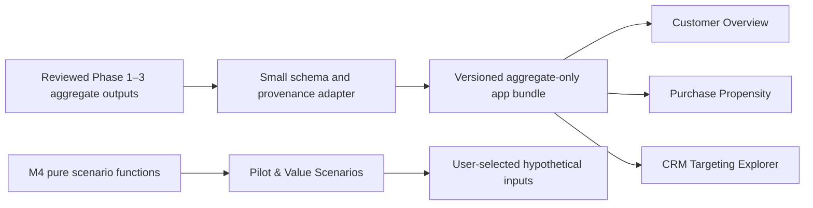

# M5-001 — Customer Intelligence & Decision Support

## Purpose and recommendation

Build a compact, local-first four-page analytical application called **Customer Intelligence & Decision Support**. Its role is to explain the progression from observed purchasing patterns to historical propensity, retrospective targeting and a hypothetical randomized-pilot plan. It is a research exhibit and planning tool, not a live scoring or campaign-execution system.

Use a small Streamlit multipage UI, backed by a versioned **aggregate-only result bundle** and the existing M4 scenario functions. Streamlit is not installed in the current environment or either requirements file, and no Dash/Plotly/Altair app exists. Its official multipage pattern supports a single entry point with page routing via `st.Page` and `st.navigation` ([Streamlit multipage documentation](https://docs.streamlit.io/develop/concepts/multipage-apps/page-and-navigation)). Add it only to an app-specific dependency file when implementation begins; keep the research runtime unchanged. Native tables, controls and charts are sufficient for this product, so no second charting framework is needed.

## Repository and artifact inventory

The repository is at `main`, HEAD `d01434fb04850630d8e7747aca10ea773af1300c`, with a clean worktree at inspection. There is no existing interactive application. `dashboards/` contains two historical V1 dashboard images; its README explicitly warns that they are not corrected-V2 results or validated current scoring evidence. Existing dashboard/data-dictionary documents describe BI/Tableau outputs, not reusable web-app code.

| Area | Verified assets and status | App use and limits |
| --- | --- | --- |
| Corrected V2 overview | `reports/corrected_v2/corrected_v2_scientific_results.md` and four SVGs are tracked. Aggregate CSVs and reconciliation JSON are present locally in ignored `data/processed/corrected_v2_customer_analytics/`: concentration, mature 90-day repeat by first-observed month, first-observed cohort activity, segment summaries, flags and reconciliation. | Reuse only the aggregate tables and published definitions. These local inputs are not in Git, so a clean checkout cannot load them. Package a small reviewed aggregate bundle for the app. Do not use the customer-level `customer_metrics.csv`, `customer_value_segment_flags.csv` or `signed_merchandise_sensitivity_customers.csv`. |
| M1 Day-21 | Results/protocol/review are tracked. External M1-007 cohort Parquet and split manifest are present locally (5,852 rows with customer IDs and label/feature fields). The experiment retained aggregate results, not saved customer-level predictions or a fitted model artifact. | Display the reported aggregate result only; do not score customers or rerun the baseline. The cohort Parquet is not an app input. |
| M2 established-customer model | Results and independent review are tracked. External corrected snapshot Parquet, model JSON, test-prediction Parquet and run manifest exist locally. The run manifest contains machine-readable aggregate metrics and partition counts; frozen predictions have 21,672 customer rows and include customer IDs, labels and probabilities. | Use aggregate result fields only. Do not load row-level predictions or invoke `run_experiment()` in the app; it fits models. Preserve the mature July–November 2011 holdout and its previously examined status. |
| M2 calibration | Tracked report/review and an external aggregate JSON are present. The aggregate contains calibration pools, monthly metrics, pooled September–November comparisons and limitations. A separate row-level prediction Parquet also exists externally. | Display the lagged intercept result as exploratory and same-holdout analysis. Use aggregate JSON only; do not apply calibration to new customers. |
| M3 targeting | Tracked aggregate report/review and an external aggregate JSON/manifest exist. The final selections Parquet has 22,779 rows with customer IDs, outcomes, policy and score. The report contains pooled/monthly precision, capture, lift, overlap and clustered intervals. | Use approved aggregate JSON fields and documented tie-sensitivity disclosure. Do not load selections or claim causal campaign impact. |
| M4 pilot feasibility | Tracked design/report/review and `src/crm_pilot_feasibility.py` exist. The module exposes reusable pure calculations including `allocate_enrollment`, `mean_difference_mde`, `sample_size_scenarios`, `commercial_scenarios`, `capacity_sensitivity` and `variance_reduction_scenarios`. Aggregate scenario CSVs are temporary local outputs outside the repository. | Call the existing calculation functions for user-selected hypothetical inputs; do not depend on temporary CSVs or present their assumptions as observed business facts. No CRM/finance inputs or treatment effect is available. |

All Phase 2 Parquets inspected are external/local and include customer-level identifiers. The M2/M3 aggregate JSON and M4 scenario outputs are distinct, safe display inputs; manifests include source hashes and should be used for provenance. No customer records are needed by any proposed page.

## Reusable logic and segmentation

- **Canonical purchase definitions:** `src/monthly_customer_snapshots.py` provides the verified monthly feature/label contract (`FEATURE_COLUMNS`, `build_monthly_customer_snapshots`, `snapshot_accounting`). It is pipeline logic, not a dashboard data source; do not rebuild 51,612 snapshots on each page request.
- **Model results:** `src/monthly_purchase_baselines.py` has frozen-input verification and metric helpers, but `run_experiment()` fits models. Reuse its established results through aggregate outputs; never call the fitting runner from the UI. `src/monthly_purchase_calibration.py` has the existing historical-availability and metric logic, while its aggregate result JSON is the better display input. `src/monthly_targeting_policies.py` can recompute selections/bootstrap and writes row-level selections; the app should not call `run_analysis()` or `write_outputs()`.
- **M4:** the calculation functions above are directly reusable for scenario controls. Existing inputs allow arbitrary population/capacity/SD/cost/effect values without introducing a data service.
- **Customer segmentation:** corrected V2 has a six-cell descriptive frequency × recency summary built by `docs/recovery/COMMERCIAL_DS_007C_VALUE_SEGMENTS.py::build_descriptive_segments`, summarized in `segment_summary.csv`. It describes observed purchase-day frequency and recency as of the partial source endpoint 2011-12-09; it is exhaustive for 5,852 identified customers but is not a validated churn segmentation or CRM targeting rule. Reuse as a clearly labelled historical descriptive view only. `reports/customer_segmentation_strategy.md`, notebook segmentation, and `src/customer_metrics.py` use historical V1/invoice-level conventions and are not substitutes for the corrected canonical segment definitions.

## Four-page product structure

| Page | User question | Supported components | Evidence label and guardrail |
| --- | --- | --- | --- |
| **A — Customer Overview** | What did customers do in the corrected observation period? | Identified customer and qualifying occasion counts; identified qualifying gross merchandise and top-decile concentration; mature 90-day second-purchase results by first-observed month with eligible/mature denominators; first-observed cohort activity matrix with immature cells shown as unavailable; six descriptive frequency/recency groups. | **Historical description.** State that first observed is not verified acquisition; £17.124m is qualifying gross merchandise, not net sales/profit; 90-day repeats are stratified with no pooled rate; month 0 is entry by construction; final December 2011 source date is partial. Segment cutoffs are display conventions, not CRM rules. Keep M2’s rolling-365-day active population separate from this full-observation Phase 1 population. |
| **B — Purchase Propensity** | How well did historical features rank future purchasers? | A clearly separated M1 Day-21 new-customer result and M2 established-customer Model A/B/C comparison. Show M2 monthly test AUC/prevalence, calibration gap and optional exploratory sequential adjustment; include top-decile precision/lift and model comparison. | **Historical prediction.** M1 primary AUC 0.519, CI [0.441, 0.596], criterion not met; do not frame as a success or choose gross-only post hoc. M2 Model C AUC 0.766, AP 0.566, top-decile precision 69.3%, lift 2.95×. Explain seasonal shift, repeated snapshots/customer dependence, one already examined holdout, underprediction, and no generalisation/deployment claim. Calibration improvement is exploratory, not a new holdout. |
| **C — CRM Targeting Explorer** | What would historical targeting lists have captured at different capacities? | M3 aggregate comparisons of full model, RFM, frequency and random expectation at 5/10/20%, with monthly and pooled precision, purchase capture, lift, overlap and customer-cluster intervals. Include a policy/capacity selector over existing results, not customer-level ranking. | **Retrospective targeting, not causality.** The 10% pooled precision was 69.35% for Model C, 68.80% for frequency, 67.24% for RFM and 23.50% random expectation. Show frequency tie sensitivity and conditional intervals; the observed holdout is reused and small point differences should not be overstated. Do not expose selected customers or imply that propensity equals treatment response. |
| **D — Pilot & Value Scenarios** | What sample and economics might a future randomized pilot require? | Inputs for unique eligible population, enrollment capacity, hypothetical margin SD, contact cost and assignment-scale gross contribution. Display treatment/control counts, MDE, break-even contribution and total/average scenario value. Optionally show baseline-covariate variance-reduction factors only as hypothetical. | **Hypothetical planning.** Label every input as an assumption; distinguish positive expected net value, MDE/power and rollout evidence. The contact-cost scenarios charge once per treatment assignment. Do not enter or imply observed CRM eligibility, margin, campaign performance or treatment effect. Link to M4-001 decisions and missing finance/CRM inputs. |

Page A must not combine lifetime full-history counts, M2's monthly active population and M1's acquisition proxy into one denominator. Use small population/time-window captions on each chart. Page B should use task-specific headings and never put M1 and M2 AUCs in an unlabeled league table because their populations, features and splits differ.

## Data and application architecture

Use one small UI entry point and four page functions. A lightweight data adapter validates schemas, provenance identifiers and permitted columns; it serves only aggregate values to pages. Store the app's reviewed aggregate bundle in a small, versioned `app_data/` directory so a clean checkout works without ignored `data/` or local `source_data/`. Bundle contents should be limited to: selected corrected-V2 aggregate CSV/JSON tables; small M1 result metrics; the aggregate M2 baseline/run-manifest metrics; M2 calibration aggregate JSON; M3 aggregate JSON; and a bundle manifest with source hashes, report paths, definitions and refresh date. M4 inputs are interactive and calculated in memory. Do not bundle raw UCI files, customer metrics, snapshots, prediction rows, targeting selections, model binaries, or full input manifests if they contain local paths.

The aggregate bundle is a **small additional export**: M1 metrics currently live only in the report, corrected-V2 aggregate CSVs are ignored local files, and Phase 2 aggregate artifacts are outside Git. A build/validation script should take configurable external input paths and emit only allowlisted aggregate fields. Until that bundle exists, the app is not self-contained in a fresh checkout. The app must fail with a clear missing-bundle message rather than silently recomputing or substituting V1 data.

Keep source paths configurable and outside tracked code. The UI should make no network calls and have no database, API service, feature store, login system or cloud dependency in this milestone. Treat the app as a local research demonstrator; deployment/publication is a separate decision.

## Evidence and integrity rules

1. Keep an evidence badge on every page/chart: **Historical description**, **Historical prediction**, **Retrospective targeting**, or **Hypothetical scenario**.
2. Put population, time window, source endpoint/maturity and metric denominator beside the visual. Null/immature cohort cells stay blank/hatched, never zero.
3. Load only explicit aggregate allowlists. Reject columns such as `customer_id`, outcome-row predictions, policy-score selections or line-level records.
4. Validate bundle source hashes against the checked-in manifest; surface the report identifier and source versions in a compact “Definitions and provenance” expander.
5. Keep historical results frozen. Interactive controls may filter displayed months/capacities or change M4 hypothetical inputs, but must not refit/recalibrate models, recompute target selections, or select a favorable output.
6. No customer lookup, downloadable recipient list, individualized recommendations, or treatment-effect estimates. The UCI study cannot support them.

## Minimal implementation sequence

1. Build the aggregate-only bundle from the verified local outputs using configurable paths; include M1 aggregate results from its report and validate all counts/metrics against the research documents. Add a short schema/manifest and tests for allowed columns, counts, hashes and missing/immature cells.
2. Add one pinned app dependency file and an entry point with four pages. Load the bundle once; use small page functions and simple native charts/tables.
3. Wire Page D to `allocate_enrollment()` and `mean_difference_mde()` plus the M4 commercial formulas; keep all scenario inputs visibly hypothetical and avoid writing output files during a session.
4. Run focused data-contract and application smoke checks; inspect each page for metric labels, readable chart scales, evidence badges and absence of row-level data.

The first implementation milestone should deliver the **aggregate bundle, provenance validation, and four-page local prototype together**. A bundle-only phase would leave no user-visible product, while a UI that depends on ignored/external row-level artifacts would not be reproducible. Do not add model retraining, targeting-list creation, campaign execution, uplift modeling or cloud deployment.

## Genuine blockers and decisions

- **No self-contained Phase 2 aggregate bundle exists yet.** Required source aggregate files/artifacts are available on this machine, but are ignored or outside the repository. The bundle/export step is required for a reproducible app.
- **No live CRM or financial data exists here.** Page D is scenario planning only; it cannot show current reach, actual contact costs, net contribution, or causal impact.
- **The legacy segmentation and Tableau artifacts are not current CRM rules.** Page A can show the corrected V2 descriptive six-group summary only with its endpoint and limitations visible.
- The owner may later choose a deployment environment and approve publication of the aggregate research bundle. Neither is necessary for a local prototype and neither is decided here.

No model, targeting experiment or scenario experiment was run for this architecture assessment. Repository contents and research outputs were read only; this plan is the only new artifact.
