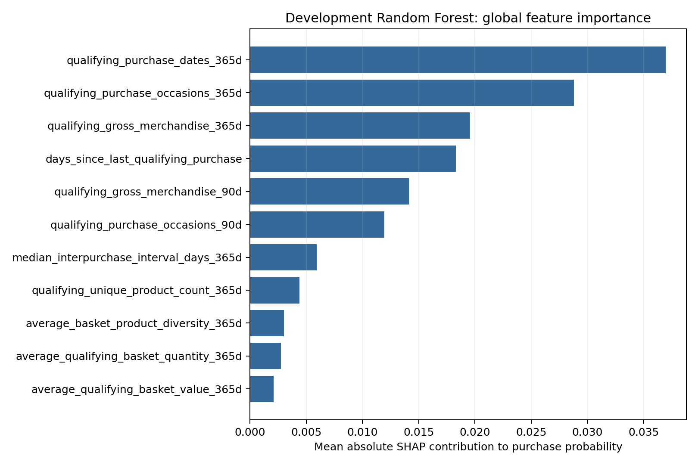
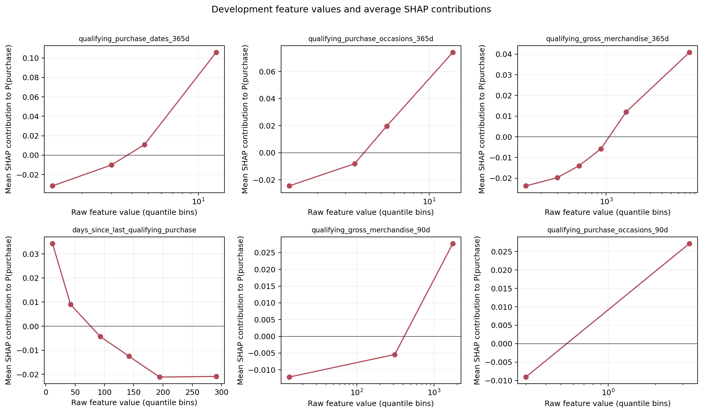
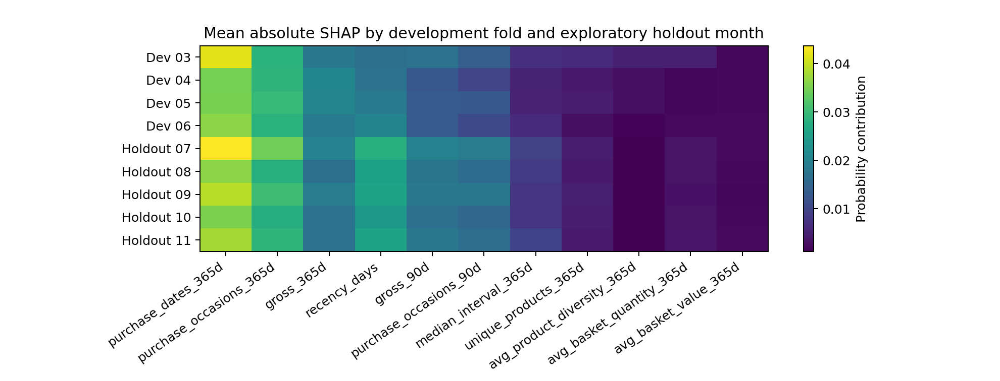
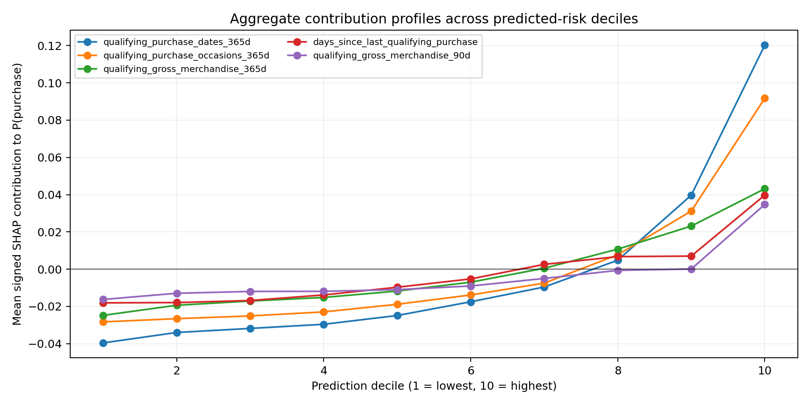

# P3-004 SHAP Explainability and Temporal Stability

## Questions and scope

This study explains how the accepted P3-002 Random Forest predicts whether an established customer makes at least one corrected-contract qualifying merchandise purchase in the next 30 days from a month-start decision time `T`. The 11 frozen features use only the fixed history window `[T - 365 days, T)`; snapshots and labels retain the M2 maturity, coverage and unknown-label rules. It asks which historical behaviours drive the model, how feature effects vary across the observed feature range, whether explanations remain stable across the four development origins, how correlated predictors complicate attribution, and how the model’s learned patterns compare with frozen Logistic C. SHAP attributes fitted predictions; it does not estimate customer response to a CRM contact or causal importance.

## Model and explanation populations

We used the selected P3-002 `RandomForestClassifier` unchanged: 200 estimators, `max_depth=8`, `min_samples_leaf=20`, `max_features="sqrt"`, `class_weight=None`, `n_jobs=1`, random seed 20261113. The established pipeline applies `log1p` and training-fold median imputation, without scaling. P3-002 Random Forest ROC-AUC, AP, Brier and log loss were reproduced exactly in all four validation folds before explanations were accepted. The model was not retuned and SHAP results were not used to select a model.

Primary explanations cover four maturity-valid validation periods. Each fold fits its own RF using only rows whose labels were mature, complete and binary before the validation decision boundary (`outcome_window_end_exclusive < boundary`). Features and imputation statistics are fitted within that training fold. The four validation populations are March (4,260 rows), April (4,318), May (4,319), and June (4,324); 17,221 total snapshots cover 4,670 unique customers, so observations repeat across months.

For bounded computation, we uniformly sampled 1,000 validation observations from each fold for SHAP (4,000 total), without replacement, using fixed PCG64 seeds and retaining source-row order. Each fold’s background was 100 uniformly sampled rows from that fold’s training population only. The secondary analysis fits the same RF on the approved 25,647 January–June training snapshots and explains a uniform sample of 1,000 from the previously examined 21,672-row July–November holdout. That replay is descriptive and exploratory; it is not an independent confirmation and did not influence model settings.

## SHAP method and numerical checks

We used SHAP 0.51.0 `TreeExplainer` on the underlying fitted forest. SHAP receives the exact 11 ordered columns after the fitted pipeline’s `log1p` transform and training-only median imputation; the raw input frame is never passed directly to the explainer. We set `model_output="probability"` and `feature_perturbation="interventional"`. The explained output is explicitly class label 1 (qualifying purchase). This avoids interpreting the raw tree output or class 0 as purchase probability. SHAP’s documentation notes that probability output is supported with interventional perturbation and that output classes may occupy a final array dimension; the analysis selects the class by `model.classes_` and verifies output reconstruction ([TreeExplainer API](https://shap.readthedocs.io/en/latest/generated/shap.TreeExplainer.html)). SHAP 0.51.0 was chosen for the project’s Python 3.11 runtime; SHAP 0.46 added NumPy 2 support and newer releases document current version requirements ([SHAP release notes](https://shap.readthedocs.io/en/stable/release_notes.html)).

For each explanation, the base value is the expected positive-class probability under that fit’s sampled training background. The local decomposition is `base value + sum(feature SHAP) ≈ model class-1 probability`. We call the explainer with its internal additivity check disabled, then perform an explicit aligned class-1 reconstruction check on every row. One absolute tolerance of 0.0002 probability units (0.02 percentage points) is used for every period. The largest observed residual was 0.0001435 (0.0144 percentage points) on the exploratory holdout; the four development-fold maxima were each below 0.00000002. Claude independently traced the holdout case to a float32 threshold-rounding discrepancy at a recency split in tree 192 of the 200-tree forest: SHAP’s compiled interventional path and scikit-learn’s prediction path handled that threshold differently. Model identity, preprocessing, class selection, background and row alignment were independently verified. The maximum per-feature attribution discrepancy for that row was approximately 0.000067, and approximately 0.24% of holdout rows have values potentially exposed to similar rounding gaps. The 0.0002 tolerance accepted the observed residual; it does not guarantee that larger threshold-related residuals cannot occur. We therefore do not claim exact additivity in all circumstances. This is a numerical reconstruction tolerance, not a model-performance tolerance.

Artifacts record SHAP version, background/explanation sampling rules and period-specific seeds, transformed feature order, additivity residuals, and the RF configuration.

## Global development importance

Mean absolute SHAP is the average magnitude of the probability contribution across explained rows. Mean signed SHAP and the share of rows with positive or negative contributions describe contribution direction relative to the model-specific background. They do not imply that changing a feature would change a customer’s behaviour.

| Rank | Feature | Mean |SHAP|, probability units | Mean signed SHAP | Positive contribution share |
|---:|---|---:|---:|---:|
| 1 | `qualifying_purchase_dates_365d` | 0.03693 (3.69 pp) | -0.00219 | 27.8% |
| 2 | `qualifying_purchase_occasions_365d` | 0.02878 (2.88 pp) | -0.00123 | 28.0% |
| 3 | `qualifying_gross_merchandise_365d` | 0.01957 (1.96 pp) | -0.00175 | 35.5% |
| 4 | `days_since_last_qualifying_purchase` | 0.01831 (1.83 pp) | -0.00254 | 32.8% |
| 5 | `qualifying_gross_merchandise_90d` | 0.01412 (1.41 pp) | -0.00436 | 18.3% |
| 6 | `qualifying_purchase_occasions_90d` | 0.01196 (1.20 pp) | -0.00338 | 15.0% |
| 7 | `median_interpurchase_interval_days_365d` | 0.00594 (0.59 pp) | -0.00107 | 34.0% |
| 8 | `qualifying_unique_product_count_365d` | 0.00440 (0.44 pp) | -0.00036 | 34.0% |
| 9 | `average_basket_product_diversity_365d` | 0.00302 (0.30 pp) | +0.00016 | 50.6% |
| 10 | `average_qualifying_basket_quantity_365d` | 0.00276 (0.28 pp) | +0.00006 | 47.0% |
| 11 | `average_qualifying_basket_value_365d` | 0.00212 (0.21 pp) | -0.00012 | 47.1% |

Purchase-date count and purchase-occasion count over 365 days lead by a wide margin, followed by gross merchandise over 365 days and recency. Their mean absolute contributions are about 3.69, 2.88, 1.96 and 1.83 percentage points respectively. Recent 90-day gross merchandise and purchase occasions are next (1.41 and 1.20 pp). Product diversity, basket quantity/value and unique product count contribute much less on average in this fitted model.

The binned RF profiles are monotone over the displayed ranges: contributions rise with the two dominant 365-day activity counts and gross merchandise, while recency contributions decline and flatten at longer gaps. These are observed binned associations with model contributions, not universal thresholds. They do not by themselves establish RF-specific nonlinear structure beyond Logistic C: Logistic C uses log1p-transformed predictors on a linear log-odds scale, whose response can appear curved and saturating when plotted against raw feature values on the probability scale. The global means and monthly ranks are descriptive point summaries; no confidence intervals were estimated for feature importance.

| Feature | Mean feature value in bin | Mean SHAP contribution |
|---|---:|---:|
| `qualifying_purchase_dates_365d` | 1.33 | -0.0316 |
| `qualifying_purchase_dates_365d` | 3.00 | -0.0101 |
| `qualifying_purchase_dates_365d` | 4.74 | +0.0108 |
| `qualifying_purchase_dates_365d` | 12.78 | +0.1058 |
| `qualifying_purchase_occasions_365d` | 1.33 | -0.0245 |
| `qualifying_purchase_occasions_365d` | 3.41 | -0.0082 |
| `qualifying_purchase_occasions_365d` | 5.43 | +0.0197 |
| `qualifying_purchase_occasions_365d` | 14.09 | +0.0742 |
| `qualifying_gross_merchandise_365d` | 136.43 | -0.0238 |
| `qualifying_gross_merchandise_365d` | 297.30 | -0.0198 |
| `qualifying_gross_merchandise_365d` | 510.85 | -0.0140 |
| `qualifying_gross_merchandise_365d` | 875.18 | -0.0059 |
| `qualifying_gross_merchandise_365d` | 1636.74 | +0.0120 |
| `qualifying_gross_merchandise_365d` | 7852.49 | +0.0408 |
| `days_since_last_qualifying_purchase` | 11.35 | +0.0343 |
| `days_since_last_qualifying_purchase` | 42.22 | +0.0090 |
| `days_since_last_qualifying_purchase` | 92.70 | -0.0043 |
| `days_since_last_qualifying_purchase` | 142.07 | -0.0125 |
| `days_since_last_qualifying_purchase` | 194.19 | -0.0211 |
| `days_since_last_qualifying_purchase` | 290.87 | -0.0208 |
| `qualifying_gross_merchandise_90d` | 13.26 | -0.0122 |
| `qualifying_gross_merchandise_90d` | 310.96 | -0.0054 |
| `qualifying_gross_merchandise_90d` | 1758.05 | +0.0277 |
| `qualifying_purchase_occasions_90d` | 0.30 | -0.0091 |
| `qualifying_purchase_occasions_90d` | 3.29 | +0.0272 |

Each row is a quantile-bin average of raw feature value and probability-scale SHAP from the 4,000 sampled development explanations; ties can reduce the number of distinct bins. The plot uses a log x-axis for purchase counts and merchandise amounts.

## Correlated predictors

We computed pairwise Spearman correlations on all 17,221 development validation rows, using the frozen raw predictors. “Strongly correlated” is defined in advance for this summary as absolute Spearman rho of at least 0.80; connected components form the displayed groups.

| Feature A | Feature B | Spearman rho |
|---|---|---:|
| `qualifying_purchase_occasions_365d` | `qualifying_purchase_dates_365d` | +0.983 |
| `qualifying_purchase_occasions_90d` | `qualifying_gross_merchandise_90d` | +0.968 |
| `days_since_last_qualifying_purchase` | `qualifying_purchase_occasions_90d` | -0.856 |
| `days_since_last_qualifying_purchase` | `qualifying_gross_merchandise_90d` | -0.842 |
| `average_qualifying_basket_value_365d` | `average_qualifying_basket_quantity_365d` | +0.829 |
| `qualifying_purchase_occasions_365d` | `qualifying_gross_merchandise_365d` | +0.819 |
| `qualifying_purchase_dates_365d` | `qualifying_gross_merchandise_365d` | +0.813 |

**Connected groups under the |rho| ≥ 0.80 rule:**

- `days_since_last_qualifying_purchase`, `qualifying_gross_merchandise_90d`, `qualifying_purchase_occasions_90d`
- `qualifying_gross_merchandise_365d`, `qualifying_purchase_dates_365d`, `qualifying_purchase_occasions_365d`
- `average_qualifying_basket_quantity_365d`, `average_qualifying_basket_value_365d`

When correlated features can substitute for one another, interventional SHAP may distribute attribution across them and combines a feature with background values that do not preserve the empirical dependence structure. The combined 365-day purchase-date / occasion / gross-merchandise group has mean absolute net group SHAP of 0.0821; the recency / 90-day occasion / 90-day gross-merchandise group has 0.0401. These grouped summaries help show shared signal, but they do not uniquely identify each feature’s share. The average basket value and quantity group is much smaller (0.00365).

## Temporal stability

The top five individual features were the same across all four development folds. Spearman correlations between full 11-feature importance rankings ranged from 0.945 to 1.000; each pair of folds shared all five top-ranked features. The April–May correlation of 1.000 is qualified because both folds use the same fitted Random Forest, as discussed below. The leading mean absolute SHAP values were similar month to month, with 365-day purchase dates first and purchase occasions second every month. The relative ordering of recency and gross merchandise shifted modestly: recency moved from rank 5 in March to rank 3 in June.

| Development period | Purchase dates 365d | Purchase occasions 365d | Gross merchandise 365d | Recency | Gross merchandise 90d |
|---|---:|---:|---:|---:|---:|
| 2011-03 | 0.0420 | 0.0283 | 0.0183 | 0.0166 | 0.0170 |
| 2011-04 | 0.0347 | 0.0288 | 0.0207 | 0.0174 | 0.0127 |
| 2011-05 | 0.0349 | 0.0297 | 0.0206 | 0.0189 | 0.0135 |
| 2011-06 | 0.0362 | 0.0283 | 0.0187 | 0.0203 | 0.0133 |

Signed means depend on the selected 100-row background distribution. Background resampling alone can materially change signed means, including their signs, so fold-to-fold sign changes are not reliable evidence of temporal behavioural shifts. April and May have identical maturity-eligible training populations and therefore share the same fitted Random Forest; differences in their explanations reflect the explained observations and sampled backgrounds, not different fitted models. The supported stability conclusion concerns mean-absolute-SHAP rankings: the top five were the same across folds, with modest changes in the relative order of recency and gross merchandise. These results do not establish concept drift or a causal change in behaviour.

The exploratory holdout has a similar ranking but a somewhat larger recency and short-window contribution magnitude. The explanation sample contains approximately 200 rows per month (203, 198, 206, 200 and 193 from July through November). Unlike the four development rows, which come from separately fitted fold models, all five holdout month summaries use the same model fitted on January–June. Full-period outcome prevalence rises from 18.75% in July to 32.14% in November, whereas the fixed model’s mean predicted probability remains near 0.17–0.18. This divergence is consistent with the already reported calibration/prevalence drift; it is not evidence that SHAP explains the outcome-rate increase.

| Exploratory month | Observed prevalence | Mean predicted probability | Dates 365d mean |SHAP| | Occasions 365d mean |SHAP| | Recency mean |SHAP| |
|---|---:|---:|---:|---:|---:|
| 2011-07 | 18.8% | 17.2% | 0.0437 | 0.0344 | 0.0280 |
| 2011-08 | 18.4% | 17.3% | 0.0363 | 0.0278 | 0.0252 |
| 2011-09 | 24.1% | 17.2% | 0.0393 | 0.0305 | 0.0259 |
| 2011-10 | 24.0% | 17.7% | 0.0353 | 0.0276 | 0.0238 |
| 2011-11 | 32.1% | 18.3% | 0.0380 | 0.0289 | 0.0257 |

## Logistic C comparison

For each development origin, one Logistic C fit used the existing frozen preprocessing and hyperparameters to obtain standardized `log1p` coefficients. Its fold metrics reproduced P3-002 to 1e-12. These are the established fold-specific reference fits; Logistic C was not retuned or fitted a second time. The Spearman correlation between RF mean-absolute-SHAP ranks and Logistic C mean-absolute-coefficient ranks is 0.455. Both models place 365-day purchase dates first; they differ on the next features, with Logistic C giving more relative weight to 90-day occasion count and average basket value, while RF emphasizes 365-day gross merchandise and recency.

| Feature | RF mean |SHAP| | Logistic C mean absolute standardized log1p coefficient | Logistic coefficient sign consistent across folds |
|---|---:|---:|---:|
| `qualifying_purchase_dates_365d` | 0.03693 | 1.123 | 100.0% |
| `qualifying_purchase_occasions_365d` | 0.02878 | 0.446 | 75.0% |
| `qualifying_gross_merchandise_365d` | 0.01957 | 0.128 | 75.0% |
| `days_since_last_qualifying_purchase` | 0.01831 | 0.101 | 100.0% |
| `qualifying_gross_merchandise_90d` | 0.01412 | 0.235 | 100.0% |
| `qualifying_purchase_occasions_90d` | 0.01196 | 0.439 | 100.0% |
| `median_interpurchase_interval_days_365d` | 0.00594 | 0.029 | 75.0% |
| `qualifying_unique_product_count_365d` | 0.00440 | 0.145 | 75.0% |
| `average_basket_product_diversity_365d` | 0.00302 | 0.119 | 75.0% |
| `average_qualifying_basket_quantity_365d` | 0.00276 | 0.068 | 75.0% |
| `average_qualifying_basket_value_365d` | 0.00212 | 0.250 | 100.0% |

The coefficient and SHAP columns have different units and estimands: standardized log1p log-odds versus additive probability contributions relative to a background. Logistic C uses log1p-transformed predictors linearly on the log-odds scale; on raw-feature probability plots its response curves can appear curved and saturating. We compare direction and rank only. Correlated inputs can also make logistic coefficients unstable and redistribute tree attributions, so neither ranking is a unique behavioural decomposition.

## Representative local explanations

For every period, private individual cases were selected as the explained-sample rows nearest the 10th, 50th and 90th percentiles of model-predicted probability (source order breaks ties). This produced 12 development cases and 3 holdout cases. Their customer IDs, feature values and row-level SHAP vectors are in the private external parquet only. No individual records appear in Git.

The public summaries below aggregate the same development explanations by prediction decile (400 sampled rows per decile); they are observed group summaries, not synthetic customers or individual examples. In low-risk decile 1, average predicted probability is 2.14% versus 4.25% observed, and the dominant 365-day counts and gross merchandise make negative contributions relative to their fold backgrounds. In decile 10, mean predicted probability is 55.22% versus 63.50% observed; purchase dates contribute +0.1202 on average, occasions +0.0917, gross merchandise +0.0432, and recency +0.0397. These decile averages illustrate the model’s composition and its underprediction at the high end; they do not describe a particular customer.

| Prediction decile | Mean predicted probability | Observed prevalence | Dates 365d mean SHAP | Occasions 365d mean SHAP | Gross 365d mean SHAP | Recency mean SHAP |
|---:|---:|---:|---:|---:|---:|---:|
| 1 | 2.1% | 4.2% | -0.0396 | -0.0283 | -0.0248 | -0.0181 |
| 5 | 7.8% | 7.2% | -0.0249 | -0.0188 | -0.0117 | -0.0097 |
| 10 | 55.2% | 63.5% | +0.1202 | +0.0917 | +0.0432 | +0.0397 |

## Commercial interpretation and limitations

- Historical purchasing frequency and breadth of purchase dates are the strongest model signals. Recent purchasing and accumulated 365-day gross merchandise add useful but smaller signal; very recent purchase activity can push propensities upward, while long time since last purchase pushes them down.
- The displayed RF profiles are monotone and do not alone demonstrate additional nonlinear structure beyond Logistic C. P3-002’s modest predictive improvement for RF is separate evidence that it captures useful predictive differences, but does not identify their precise functional form. The SHAP profiles are conditional on the forest and correlated inputs.
- These signals may inform descriptive CRM strata or prioritisation tests, such as separating recently active customers from long-lapsed customers and examining activity depth. Monetary features measure gross merchandise, not margin or customer value.
- The target is next-month purchasing propensity. SHAP does not indicate who will incrementally purchase because of a message, which contact causes harm, or how to allocate offers. Those questions require randomized campaign evidence and causal/uplift analysis.
- P3-002 reported that the RF underpredicts holdout prevalence: observed prevalence is 23.50% while mean predicted probability is 17.55%; its calibration intercept/slope were 0.461/0.997. SHAP faithfully decomposes the model probability, not the observed event rate. Under prevalence drift, explanations remain explanations of the model’s score, not calibrated future purchase risk.
- Interventional attribution depends on the chosen background and can evaluate combinations that are rare under the data distribution. High correlation, repeated customers, short historical periods, sampled explanations and separate fold fits limit uniqueness and temporal claims. Random Forest feature subsampling may distribute predictive importance among correlated substitutes. The bootstrap or variation across folds is not a confidence interval for causal feature effects.

## Runtime, reproducibility and artifacts

The final run took 116.19 seconds wall time (113.14 seconds measured experiment time excluding plot generation), with 114.82 seconds user CPU and 0.66 seconds system CPU. `/usr/bin/time -l` reported maximum resident set size 423,198,720 bytes and peak memory footprint 386,106,400 bytes as distinct measurements. RF fitting took about 8.80 seconds total across four development folds and the exploratory full-training fit. SHAP explanation computation took about 103.82 seconds across 5,000 explained rows.

Versions: Python 3.11.14, NumPy 2.4.4, scikit-learn 1.8.0, pandas 3.0.2, SciPy 1.17.1, SHAP 0.51.0. `shap==0.51.0` was added to `requirements.txt`; `matplotlib==3.10.9` was already pinned. The run uses fixed RF seed 20261113, PCG64 sampling seeds recorded by period, and deterministic one-thread RF execution.

Aggregate-only results, provenance and private row-level explanations are stored outside Git under `source_data/uci_online_retail_ii/p3_004_outputs/`. The private file is `private/p3_004_individual_shap_explanations.parquet`; it contains customer identifiers, features and SHAP rows and must remain private. The aggregate JSON contains no customer identifier or row-level prediction. Four aggregate-safe figures are in `docs/research/figures/`. Rerunning the SHAP runner overwrites the generated figures under `docs/research/figures/`.

## Future questions

Before operational use, test explanation stability on genuinely future observations, assess probability calibration under future prevalence, and compare attribution behavior under alternative dependence-aware background/perturbation assumptions. Keep all feature-importance claims predictive, and evaluate CRM changes through randomized tests.
