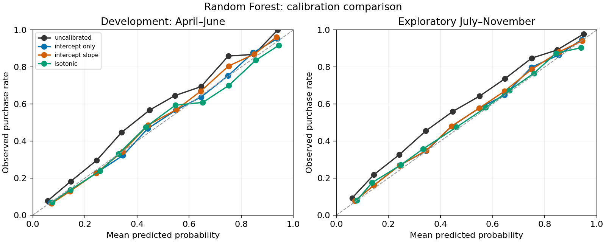
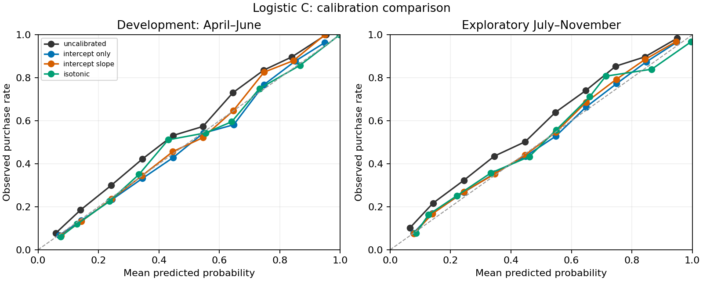
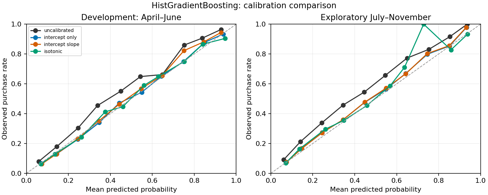

# P3-005 — Probability Calibration, Temporal Drift and CRM Decision Uncertainty

## Objective and scope

This experiment assesses whether post-hoc probability calibration improves the accepted M2 next-month purchase propensity estimates, and whether the correction is stable enough to inform CRM decisions. The primary classifier is the accepted P3-002 Random Forest configuration 0 (200 trees, depth 8, minimum leaf size 20, `max_features="sqrt"`, no class weighting, one thread, seed 20261113). Comparators are frozen Logistic C and P3-002 HistGradientBoosting configuration 0. No classifier was retuned.

The target, established-customer population, monthly decision snapshots, 30-day qualifying-purchase label, 365-day history window, 11 features, eligibility, unknown-label handling and fold-local preprocessing remain the accepted M2 definitions. Probability clipping for calibrator fitting and log-loss computation is `1e-6` at each end of `[0,1]`; the clipping bound and gradient tolerance are recorded in the aggregate artifact.

The calibration maps are:

1. **Uncalibrated:** accepted model probability.
2. **Intercept-only:** solve for an additive logit shift so mean mapped probability matches earlier calibration-pool prevalence.
3. **Intercept and slope:** unpenalized logistic recalibration, `expit(a + b * logit(clipped_probability))`.
4. **Isotonic:** monotone isotonic regression. The predeclared feasibility minimum is 1,000 calibration rows and at least 100 observations from each class; every used pool exceeds it.

Calibration estimates use only predictions made out of fold: each source snapshot's score came from a model trained before that snapshot's decision time. Calibration labels must be complete, binary and mature strictly before the evaluation decision boundary. They are never fit on the corresponding evaluation outcomes. There is only one calibration-map update in the development schedule, for June. April and May use the same Random Forest fitted on the identical January–March training observations and the same calibration map fitted from March out-of-fold predictions. Repeated customers and overlapping outcomes remain dependent.

## Feasible temporal schedule

The source contains four M2 development folds, March–June. March cannot be evaluated after calibrating on any earlier out-of-fold predictions. The following three chronological evaluation months are feasible:

| Evaluation month | Earlier calibration months | Calibration rows / positives / customers | Latest label end | Evaluation rows / positives |
|---|---|---:|---|---:|
| April | March | 4,260 / 755 / 4,260 | March 31 | 4,318 / 739 |
| May | March | 4,260 / 755 / 4,260 | March 31 | 4,319 / 901 |
| June | March–May | 12,897 / 2,395 / 4,554 | May 31 | 4,324 / 868 |

The strict maturity rule is `outcome_window_end_exclusive < evaluation decision time`. April labels end exactly on the May 1 boundary, so they are unavailable for May calibration. May labels end May 31 and are eligible by June 1. The three evaluation months contain 12,961 snapshots and 2,508 positive outcomes. They are not three independent replications: customers overlap and labels are temporally dependent. The customer-cluster bootstrap interval excluding zero reflects customer resampling conditional on these evaluated months and fitted maps; it does not measure variation across future periods.

For the exploratory July–November replay, calibrators use only out-of-fold March–May predictions: 12,897 snapshots, 2,395 positives and 4,554 customers, with all labels ending before July 1. June is excluded by the same strict rule. The accepted full January–June models are scored on the previously examined holdout. Holdout outcomes never fit calibration maps or influence method selection. Applying maps learned from month-specific fold models to full-training-model scores is a transfer assumption and limits this descriptive replay.

## Development results

Results below pool the matched April–June evaluation rows. Calibration improves probability loss while leaving ranking essentially unchanged for intercept-only and intercept-and-slope maps. Isotonic creates score ties and reduces AP. Diagnostics report the fitted calibration intercept and slope on each evaluated score set; ideal values are 0 and 1. A diagnostic fit is reported only after a finite stationary solution with a well-conditioned information matrix; a numerical optimizer warning is distinguished from actual non-estimability.

| Model | Calibration | ROC-AUC | AP | Brier | Log loss | Mean predicted | Observed prevalence | Logistic recalibration intercept (slope estimated jointly) / slope |
|---|---|---:|---:|---:|---:|---:|---:|---:|
| Random Forest | Uncalibrated | 0.7827 | 0.5479 | 0.12377 | 0.40185 | 0.1566 | 0.1935 | 0.370 / 1.029 |
| Random Forest | Intercept-only | 0.7827 | 0.5479 | **0.12189** | **0.39584** | 0.1998 | 0.1935 | -0.015 / 1.030 |
| Random Forest | Intercept and slope | 0.7830 | 0.5473 | 0.12211 | 0.39654 | 0.1998 | 0.1935 | 0.074 / 1.102 |
| Random Forest | Isotonic | 0.7801 | 0.5313 | 0.12241 | 0.39920 | 0.1984 | 0.1935 | -0.048 / 0.993 |
| Logistic C | Uncalibrated | 0.7748 | 0.5350 | 0.12541 | 0.40665 | 0.1573 | 0.1935 | 0.328 / 1.008 |
| Logistic C | Intercept-only | 0.7750 | 0.5351 | 0.12380 | 0.40096 | 0.2006 | 0.1935 | -0.045 / 1.009 |
| Logistic C | Intercept and slope | 0.7753 | 0.5345 | 0.12392 | 0.40153 | 0.2001 | 0.1935 | 0.061 / 1.093 |
| Logistic C | Isotonic | 0.7740 | 0.5184 | 0.12437 | 0.40243 | 0.2003 | 0.1935 | 0.019 / 1.058 |
| HistGradientBoosting | Uncalibrated | 0.7813 | 0.5450 | 0.12418 | 0.40300 | 0.1560 | 0.1935 | 0.393 / 1.042 |
| HistGradientBoosting | Intercept-only | 0.7814 | 0.5450 | **0.12218** | **0.39681** | 0.1999 | 0.1935 | 0.000 / 1.043 |
| HistGradientBoosting | Intercept and slope | 0.7817 | 0.5446 | 0.12237 | 0.39738 | 0.1996 | 0.1935 | 0.076 / 1.102 |
| HistGradientBoosting | Isotonic | 0.7789 | 0.5285 | 0.12285 | 0.40189 | 0.1993 | 0.1935 | -0.037 / 1.007 |

The table's logistic recalibration intercept estimates the intercept jointly with the displayed slope; it is not calibration-in-the-large. For RF, the independently verified slope-fixed calibration-in-the-large offset is +0.323 uncalibrated and -0.051 after intercept-only recalibration.

The customer-cluster paired bootstrap resampled complete customer trajectories 1,000 times using fixed customer multiplicity weights. Differences are calibrated minus uncalibrated on exactly matched evaluation rows; negative loss differences favor calibration. Intervals condition on fitted base models, fitted maps and the evaluated months. They do not include calibration-map estimation uncertainty, dependence from shared out-of-fold calibration observations and the June map update, or variation across future periods.

| Model | Method | Δ Brier (95% CI) | Δ log loss (95% CI) |
|---|---|---:|---:|
| Random Forest | Intercept-only | -0.00188 [-0.00262, -0.00111] | -0.00601 [-0.00835, -0.00384] |
| Random Forest | Intercept and slope | -0.00166 [-0.00231, -0.00096] | -0.00531 [-0.00743, -0.00298] |
| Random Forest | Isotonic | -0.00136 [-0.00208, -0.00064] | -0.00265 [-0.00592, +0.00116] |
| Logistic C | Intercept-only | -0.00161 [-0.00233, -0.00084] | -0.00569 [-0.00799, -0.00357] |
| Logistic C | Intercept and slope | -0.00149 [-0.00213, -0.00082] | -0.00512 [-0.00727, -0.00279] |
| Logistic C | Isotonic | -0.00104 [-0.00174, -0.00035] | -0.00422 [-0.00666, -0.00176] |
| HistGradientBoosting | Intercept-only | -0.00200 [-0.00276, -0.00122] | -0.00618 [-0.00847, -0.00398] |
| HistGradientBoosting | Intercept and slope | -0.00181 [-0.00250, -0.00110] | -0.00562 [-0.00775, -0.00327] |
| HistGradientBoosting | Isotonic | -0.00133 [-0.00205, -0.00062] | -0.00111 [-0.00552, +0.00357] |

### Monthly calibration stability

For the primary Random Forest, uncalibrated mean scores remain below prevalence in each development month. Intercept-only recalibration improves Brier and log loss in May and June, while April is slightly worse. This is a small temporal sample, not a universal correction guarantee.

| Month | Prevalence | Uncalibrated mean | Intercept-only mean | Uncalibrated Brier → recalibrated | Uncalibrated log loss → recalibrated |
|---|---:|---:|---:|---:|---:|
| April | 0.171 | 0.151 | 0.195 | 0.1149 → 0.1156 | 0.3811 → 0.3817 |
| May | 0.209 | 0.151 | 0.194 | 0.1301 → 0.1253 | 0.4178 → 0.4037 |
| June | 0.201 | 0.167 | 0.210 | 0.1263 → 0.1248 | 0.4067 → 0.4022 |

The RF Brier changes at full precision are +0.00065 for April (worse), -0.00481 for May and -0.00149 for June. March prevalence was about 17.7%, compared with 17.1% in April and 20.9% in May. The April and May correction is the same map applied to the same fitted RF; the pooled loss improvement is driven primarily by May and secondarily by June. June is the only map update in these development evaluations. The paired interval excluding zero reflects variation across customers conditional on these months and maps, not temporal or future-period variation.

Calibration bins use fixed 0.1 probability widths with empty bins retained. The uncalibrated RF is under the observed rate in most populated probability ranges; intercept-only calibration brings the pooled development reliability curve closer to the diagonal. The upper development reliability bins contain approximately 59–149 observations and are correspondingly less stable.

| RF period and score | Probability bin | n | Mean predicted | Observed purchase rate |
|---|---:|---:|---:|---:|
| Development uncalibrated | [0.0, 0.1) | 6,792 | 0.057 | 0.077 |
| Development uncalibrated | [0.1, 0.2) | 3,131 | 0.146 | 0.182 |
| Development uncalibrated | [0.2, 0.3) | 1,386 | 0.245 | 0.296 |
| Development intercept-only | [0.0, 0.1) | 5,077 | 0.067 | 0.067 |
| Development intercept-only | [0.1, 0.2) | 3,392 | 0.143 | 0.130 |
| Development intercept-only | [0.2, 0.3) | 1,916 | 0.244 | 0.228 |
| Exploratory holdout uncalibrated | [0.0, 0.1) | 9,927 | 0.060 | 0.092 |
| Exploratory holdout uncalibrated | [0.1, 0.2) | 5,826 | 0.144 | 0.219 |
| Exploratory holdout uncalibrated | [0.2, 0.3) | 2,518 | 0.242 | 0.327 |
| Exploratory holdout intercept-only | [0.0, 0.1) | 7,129 | 0.071 | 0.078 |
| Exploratory holdout intercept-only | [0.1, 0.2) | 6,050 | 0.144 | 0.162 |
| Exploratory holdout intercept-only | [0.2, 0.3) | 3,611 | 0.242 | 0.269 |

## Previously examined holdout: exploratory replay only

This is not independent confirmation. No July–November outcomes were used to fit a map or choose a method. Holdout entries below are a descriptive replay with maps fitted from March–May development out-of-fold scores.

| Model | Calibration | ROC-AUC | AP | Brier | Log loss | Mean predicted | Observed prevalence |
|---|---|---:|---:|---:|---:|---:|---:|
| Random Forest | Uncalibrated | 0.7732 | 0.5758 | 0.14596 | 0.46009 | 0.1755 | 0.2350 |
| Random Forest | Intercept-only | 0.7732 | 0.5758 | 0.14187 | 0.44659 | 0.2198 | 0.2350 |
| Random Forest | Intercept and slope | 0.7732 | 0.5758 | 0.14190 | 0.44662 | 0.2196 | 0.2350 |
| Random Forest | Isotonic | 0.7730 | 0.5574 | 0.14230 | 0.44928 | 0.2187 | 0.2350 |
| Logistic C | Uncalibrated | 0.7660 | 0.5659 | 0.14744 | 0.46489 | 0.1769 | 0.2350 |
| Logistic C | Intercept-only | 0.7660 | 0.5659 | 0.14380 | 0.45199 | 0.2212 | 0.2350 |
| Logistic C | Intercept and slope | 0.7660 | 0.5659 | 0.14381 | 0.45200 | 0.2206 | 0.2350 |
| Logistic C | Isotonic | 0.7650 | 0.5462 | 0.14438 | 0.45613 | 0.2206 | 0.2350 |
| HistGradientBoosting | Uncalibrated | 0.7742 | 0.5759 | 0.14623 | 0.46027 | 0.1746 | 0.2350 |
| HistGradientBoosting | Intercept-only | 0.7742 | 0.5759 | 0.14189 | 0.44636 | 0.2198 | 0.2350 |
| HistGradientBoosting | Intercept and slope | 0.7742 | 0.5759 | 0.14191 | 0.44639 | 0.2197 | 0.2350 |
| HistGradientBoosting | Isotonic | 0.7732 | 0.5579 | 0.14229 | 0.44764 | 0.2177 | 0.2350 |

The development-only intercept adjustment moves RF mean prediction upward by about 4.4 percentage points but still leaves a 1.5-point pooled shortfall. By month, RF prevalence rises from 18.8% in July to 32.1% in November while uncalibrated mean scores move only from 17.2% to 18.3%; after the fixed development adjustment, means are about 21.6%–22.9%. The score distribution is comparatively stable (RF median around 0.10–0.13 and 90th percentile around 0.38–0.40), while observed rates within fixed probability bins rise in later periods. This is evidence of both prevalence change and changed conditional purchase rates across score bands, not proof of a single mechanism. The monthly pattern also shows the global intercept correction can overpredict both July and August and materially underpredict November. These observations are descriptive because this holdout was previously examined.

## CRM capacity decisions and probability thresholds

For the primary RF, monthly ranks and deterministic customer-key ties are unchanged by intercept-only or positive-slope recalibration. Thus fixed-capacity selection is identical in each evaluation month. The isotonic map creates flat segments and ties, which the approved policy resolves by customer ID; small targeting changes result, but paired customer-bootstrap intervals span zero.

| RF method, development April–June equal-month mean | Top 5% precision / capture / lift | Top 10% precision / capture / lift | Top 20% precision / capture / lift |
|---|---:|---:|---:|
| Uncalibrated | 77.50% / 20.10% / 4.01 | 65.61% / 33.95% / 3.39 | 49.98% / 51.65% / 2.58 |
| Intercept-only | 77.50% / 20.10% / 4.01 | 65.61% / 33.95% / 3.39 | 49.98% / 51.65% / 2.58 |
| Intercept and slope | 77.50% / 20.10% / 4.01 | 65.61% / 33.95% / 3.39 | 49.98% / 51.65% / 2.58 |
| Isotonic | 77.81% / 20.20% / 4.03 | 66.31% / 34.31% / 3.43 | 49.36% / 50.97% / 2.55 |

The main CRM table reports equal-month means of monthly metrics. Monthly lift is calculated relative to that evaluated month's observed purchase prevalence. Paired CRM point differences are pooled across months and weighted by the number selected. These are different aggregation conventions and should not be read as identical estimands.

Paired RF isotonic-minus-uncalibrated CRM differences (customer-cluster 95% intervals) were: 5% precision +0.0031 [-0.0092, +0.0200], capture +0.0008 [-0.0024, +0.0052]; 10% precision +0.0069 [-0.0085, +0.0139], capture +0.0036 [-0.0043, +0.0071]; 20% precision -0.0062 [-0.0124, +0.0031], capture -0.0064 [-0.0130, +0.0033]. The correction therefore does not establish an operational targeting gain. Intercept-only and intercept-slope CRM differences are exactly zero under the deterministic capacity policy. Monthly precision varied substantially with month and underlying prevalence, so equal-month averages should not be read as a stable campaign yield.

A fixed `P >= 0.20` threshold is shown as a descriptive volume/yield illustration, not a cost-optimal rule. For RF, it selects roughly 22.7%–25.1% of development rows before calibration and 33.7%–35.6% after the sequential intercept adjustment. On holdout, the share rises from 26.7%–28.7% to 37.1%–42.8%. Threshold decisions depend on predicted probability and expected contact costs/benefits; those economics are unavailable here. A calibrated probability can make a fixed threshold easier to interpret, but it does not by itself improve fixed-capacity ranking or demonstrate incremental CRM impact.

## Calibration drift, method choice and limitations

In the pooled development predictions, RF mean probability is 15.7% against 19.4% prevalence, and the joint logistic recalibration intercept/slope are 0.370/1.029. This is a pooled calibration signal, not evidence of a temporally robust correction: April and May use the same model and map, April loss slightly worsens, and most of the pooled gain comes from May with a smaller contribution from June. The simple intercept-only map improves pooled RF Brier by 0.00188 and log loss by 0.00601; paired customer-bootstrap intervals exclude zero conditional on these evaluated months. Intercept-and-slope performs slightly worse despite extra flexibility. Isotonic has a slightly smaller Brier improvement, no decisive log-loss improvement for RF/HGB, lower AP from ties, and no clear CRM gain.

**Provisional method choice:** use intercept-only recalibration as the simplest research candidate for the accepted RF, updated only from mature earlier out-of-fold predictions. This choice is supported by the limited chronological development results, not the holdout. It should not be treated as a deployment-ready probability correction: April was slightly worse, only three validation months are available, and no genuinely future evaluation period exists in UCI Online Retail II. Retain uncalibrated outputs as the reference and validate the update rule prospectively before operational probability thresholds.

Limitations include repeated customer snapshots, overlapping outcome windows, only three valid development evaluation months, changing training populations/model fits, calibration-pool estimation uncertainty not represented in the fixed-map bootstrap intervals, transfer from fold-model calibration scores to a full-training model for the descriptive replay, and prior examination of all July–November outcomes. The bootstrap quantifies customer resampling uncertainty conditional on these fixed observations and maps; it does not quantify uncertainty over future periods. Calibration is predictive and does not estimate message uplift or causal contact effects.

## Reproducibility and artifacts

The runner made 14 classifier fits: 12 fold fits (three models across four March–June folds) and two full January–June tree fits; frozen Logistic C holdout probabilities were reused. Experiment time was 14.36 seconds; total wall time was 16.21 seconds. `/usr/bin/time -l` recorded maximum resident set size of 501,334,016 bytes and peak memory footprint of 396,133,648 bytes. The environment used Python 3.11.14, NumPy 2.4.4, pandas 3.0.2, SciPy 1.17.1 and scikit-learn 1.8.0. Seeds are fixed at 20261113; the customer bootstrap uses 1,000 paired replicates.

The aggregate JSON, manifest and customer-level private prediction/calibration files are under `source_data/uci_online_retail_ii/p3_005_outputs/` outside Git. Three aggregate-safe reliability figures are saved in `docs/research/figures/`. Rerunning the P3-005 experiment overwrites these three figures. No customer-level predictions or identifiers are included in repository outputs.
