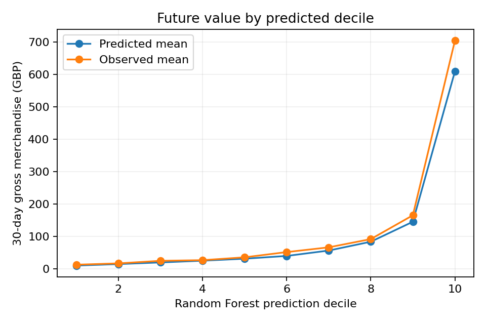
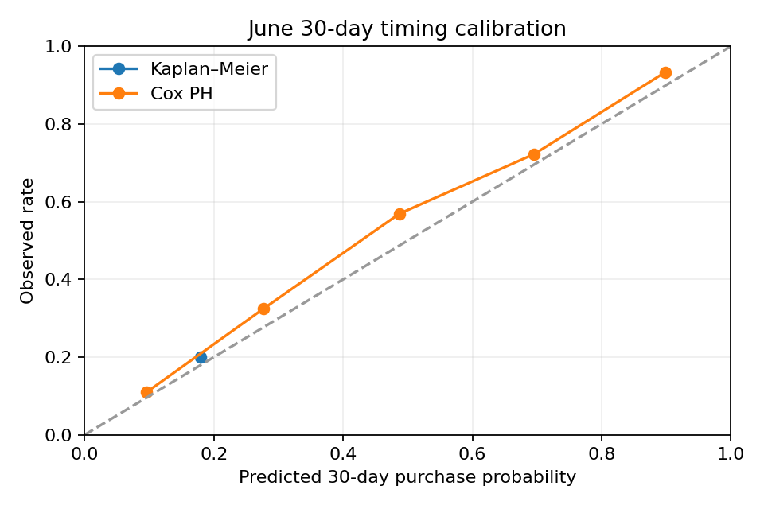

# P3-006 — Future Customer Value and Purchase Timing

## Questions and locked horizon choice

This investigation asks whether point-in-time M2 customer history can predict (1) qualifying gross merchandise value, (2) time to the next qualifying purchase, and (3) the number of qualifying purchase occasions. It extends the established-customer snapshot population and its 11 frozen predictors; it does not estimate campaign effects.

The verified M2 snapshot file contains 51,612 eligible customer-months from January–December 2011. Canonical qualifying transactions run from 1 December 2009 through 9 December 2011 at 12:50. Before comparing model performance, the horizon rule was fixed: use a primary amount/count horizon only if it has at least four strict, mature, pre-holdout monthly evaluation origins. Thirty days is primary (March–June: four origins), 60 days is secondary (April–June: three origins), and 90-day amount/count modelling is deferred (May–June: only two origins). This choice was based on evaluation coverage, not model scores.

| Horizon | Mature snapshots | Last mature decision month | Strict pre-holdout evaluation origins | Decision |
|---|---:|---|---:|---|
| 30 days | 47,319 | November 2011 | 4 | Primary |
| 60 days | 42,975 | October 2011 | 3 | Secondary, limited |
| 90 days | 38,611 | September 2011 | 2 | Defer amount/count model comparison |

Maturity is checked on actual timestamps: the target endpoint must be no later than the corrected source end. A target window is `[T, T+h)`. A mature customer with no qualifying occasion has spend and count zero; an immature row is unknown and excluded. For development folds, every training target endpoint is strictly before the first decision timestamp in its validation month. No random split is used.

## Target and feature definitions

The cohort and predictors come from frozen M2-004. A row is an eligible established-customer snapshot at month start `T`; all 11 existing predictors summarize qualifying activity in `[T−365 days, T)`. Customer identifiers, dates and target fields are never model inputs. Imputation and transformations are fit within each training fold. The exact ordered feature names are in the aggregate manifest.

Future value is the sum of positive canonical qualifying gross merchandise in the horizon, in nominal GBP. A purchase occasion is the canonical customer–invoice qualifying occasion. The recovery contract excludes cancellations, returns/non-positive quantities, non-positive prices and non-merchandise lines; the resulting target is gross qualifying merchandise, not net revenue, margin or profit. No clipping or winsorisation was used. Heavy tails remain visible: for 30-day development outcomes mean spend is £119.49, p95 £563.48, p99 £1,587.19 and maximum £41,959.44; for 60 days the corresponding values are £246.37, £973.85, £2,814.24 and £64,909.20.

## Temporal design and models

| Horizon | Evaluation month | Training snapshots | Evaluation snapshots | Positive-spend evaluations | Latest training target endpoint |
|---|---|---:|---:|---:|---|
| 30d | March | 4,205 | 4,260 | 755 | 31 Jan |
| 30d | April | 12,686 | 4,318 | 739 | 31 Mar |
| 30d | May | 12,686 | 4,319 | 901 | 31 Mar |
| 30d | June | 21,323 | 4,324 | 868 | 31 May |
| 60d | April | 4,205 | 4,318 | 1,293 | 2 Mar |
| 60d | May | 12,686 | 4,319 | 1,379 | 30 Apr |
| 60d | June | 17,004 | 4,324 | 1,328 | 31 May |

The month rows repeat customers, and adjacent outcome windows can overlap. The evaluation origins therefore are temporal checks, not independent replications. Each fold refits its own estimator and preprocessing.

Amount models were predeclared and deliberately small: training-mean constant; historical 365-day gross scaled by `h/365`; Tweedie regression (power 1.5, alpha 1, log link); Random Forest (200 trees, depth 8, leaf 20, `max_features=sqrt`); HistGradientBoosting (Poisson loss, learning rate .05, 100 iterations, 7 leaves, leaf 50, L2=1, early stopping off); and a two-part model (logistic probability of any spend times positive-only Tweedie severity). All use the same 11 features and fold-local log1p/median imputation; linear models additionally standardize. Seed: 20261113. No hyperparameter tuning was performed.

## Monetary results

Pooled snapshot-weighted development results are below. Bias is prediction minus observed spend. “Top decile capture” is the equal-month mean of the fraction of each month's total future spend captured by the top 10% ranked by prediction, with customer ID as deterministic tie-breaker. Predict-zero and Tweedie deviance diagnostics were calculated directly from the saved fold predictions.

| Horizon | Model | MAE (£) | RMSE (£) | Bias (£) | Tweedie deviance (p=1.5) | Top-decile spend capture |
|---|---|---:|---:|---:|---:|---:|
| 30d | Predict zero | 119.49 | 746.34 | −119.49 | — | — |
| 30d | Training-mean baseline | 190.87 | 736.75 | −6.19 | — | 12.0% |
| 30d | Historical rate | 149.44 | **541.69** | +35.34 | 35.42 | 60.2% |
| 30d | Tweedie regression | 136.09 | 613.13 | −21.54 | — | 58.6% |
| 30d | Random Forest | 134.85 | 588.60 | −16.06 | — | 58.1% |
| 30d | HistGradientBoosting | **128.61** | 560.49 | −19.45 | **34.91** | 60.6% |
| 30d | Two-part | 138.29 | 621.64 | −20.40 | — | 59.0% |
| 60d | Predict zero | 246.37 | 1,400.35 | −246.37 | — | — |
| 60d | Training-mean baseline | 341.97 | 1,378.79 | −27.68 | — | 12.3% |
| 60d | Historical rate | 240.44 | **805.56** | +60.77 | 39.22 | 60.9% |
| 60d | Tweedie regression | 221.86 | 1,018.41 | −56.06 | — | 60.2% |
| 60d | Random Forest | 221.59 | 1,046.45 | −48.88 | — | 59.6% |
| 60d | HistGradientBoosting | **211.34** | 946.00 | −52.20 | **38.64** | **61.6%** |
| 60d | Two-part | 231.75 | 1,099.77 | −59.40 | — | 59.8% |

The predict-zero baseline has MAE equal to mean future spend: £119.49 at 30 days and £246.37 at 60 days. About 81.1% of 30-day outcomes and 69.1% of 60-day outcomes are zero, so MAE rewards predictions near the conditional median, which is zero for many customers. HGB has the lowest MAE among fitted predictive models, but does not beat predict-zero MAE at 30 days. The historical-rate model has the lowest RMSE at both horizons; bold RMSE entries mark that result. HGB's mean-oriented Tweedie deviance advantage over historical rate is small (34.91 vs 35.42 at 30 days; 38.64 vs 39.22 at 60 days). Its 30-day top-decile spend capture is 60.6%, compared with 60.2% for historical rate. Neither model demonstrates a compelling overall improvement across monetary criteria; retain HGB and historical rate as candidates.

Across months, HGB MAE ranged £119–£133 at 30 days and £204–£222 at 60 days; monthly top-decile capture ranged 54.6–63.8% and 58.6–63.8%, respectively. RF's 30-day MAE was below historical rate in all four folds, but that comparison does not overcome the predict-zero and RMSE findings. These are short historical comparisons, not evidence of future generalisation.

Paired customer-trajectory percentile bootstrap (500 resamples, seed 20261143 for 30d / 20261173 for 60d) compares MAE on exactly matched snapshots to the historical-rate baseline. Negative differences favor the model.

| Horizon | Model − historical rate ΔMAE (£) | Conditional 95% CI |
|---|---:|---:|
| 30d | Tweedie −13.35 | [−19.26, −7.28] |
| 30d | Random Forest −14.59 | [−19.10, −9.30] |
| 30d | HistGradientBoosting −20.83 | [−25.43, −16.29] |
| 30d | Two-part −11.15 | [−16.28, −5.15] |
| 60d | Tweedie −18.59 | [−31.52, −6.12] |
| 60d | Random Forest −18.85 | [−30.67, −4.25] |
| 60d | HistGradientBoosting −29.10 | [−39.21, −18.38] |
| 60d | Two-part −8.69 | [−21.29, +6.66] |

These intervals compare MAE against the historical-rate baseline only. They do not establish superiority on RMSE, Tweedie deviance or targeting, and condition on fitted predictions and evaluated months; model-fit, horizon-selection and future-period uncertainty are not included. The two-part 60-day MAE difference is uncertain. High-value customers remain difficult: HGB underpredicted the upper training-defined historical-value tercile by about £54 per 30-day snapshot and £148 per 60-day snapshot on average, with much larger absolute errors there. A lower pooled MAE does not guarantee correct individual budgets.

The Random Forest predicted-decile figure shows useful ordering but imperfect level calibration, especially in the upper tail. Spend capture is a ranking statistic over observed outcomes; it does not estimate incremental campaign revenue. Rerunning the experiment overwrites both P3-006 figures in `docs/research/figures/`.

## Purchase-count results

The outcome is the number of distinct qualifying invoice occasions in the same mature windows, including zero. Only the primary 30-day and limited 60-day development folds are reported.

| Horizon | Model | MAE (occasions) | RMSE | Poisson deviance | Mean observed / predicted |
|---|---|---:|---:|---:|---:|
| 30d | Predict zero | **0.271** | — | — | 0.271 / 0 |
| 30d | Historical frequency rate | 0.354 | 0.578 | **0.684** | 0.271 / 0.340 |
| 30d | Poisson GLM | 0.335 | 0.630 | 0.691 | 0.271 / 0.211 |
| 60d | Predict zero | **0.561** | — | — | 0.561 / 0 |
| 60d | Historical frequency rate | 0.569 | 0.907 | 0.975 | 0.561 / 0.676 |
| 60d | Poisson GLM | 0.537 | 0.982 | **0.954** | 0.561 / 0.424 |

For 30 days, 81.1% of outcomes are zero; for 60 days, 69.1% are zero. Count MAE rewards zero predictions in this sparse setting: at 30 days predict-zero MAE is 0.271, below Poisson GLM (0.335) and historical rate (0.354). The GLM's 30-day deviance (0.691) is worse than historical rate (0.684). At 60 days the GLM deviance is better (0.954 vs 0.975), but this horizon has only three origins and the GLM underpredicts the overall mean. Count models show limited incremental predictive value; there is no convincing 30-day improvement. BG/NBD was not fitted: only a short, calendar-varying observation panel is available, customer observation/exposure and dropout assumptions are not established, and no `lifetimes`/survival-model package is installed. A longer panel with explicit customer exposure and repeat-purchase diagnostics is needed before testing it.

## Purchase timing and censoring

Time origin is snapshot decision time; event is the next canonical qualifying occasion. Since the recovery data contract stores occasion date at calendar-day resolution, elapsed time is measured in days. For training, an event after the validation cutoff is not revealed: training rows are administratively censored at that fold's decision boundary. Evaluation rows are right-censored at the last observable source boundary. Non-purchasers remain censored observations; they are never relabeled as permanent non-purchasers.

We compared a Kaplan–Meier population survival curve with a ridge-penalized Cox proportional-hazards model (alpha .1; Breslow baseline; same 11 features, log1p, fold median imputation and standardization). The primary discrimination metric is Harrell's C after truncating each evaluation observation at 30 days: retain an event only when it occurs before day 30; otherwise censor at day 30 or the earlier administrative observation boundary. This aligns concordance with the fixed 30-day question and excludes later outcome information.

| Evaluation month | Train n / events | Eval n / events / censored by source end | Cox C, truncated at 30d | KM C, truncated at 30d | Cox Brier 30d | KM Brier 30d |
|---|---:|---:|---:|---:|---:|---:|
| March | 8,426 / 1,662 | 4,260 / 2,628 / 1,632 | 0.757767 | 0.500000 | 0.118 | 0.146 |
| April | 12,686 / 3,306 | 4,318 / 2,623 / 1,695 | 0.737848 | 0.500000 | 0.116 | 0.142 |
| May | 17,004 / 5,070 | 4,319 / 2,578 / 1,741 | 0.764849 | 0.500000 | 0.131 | 0.167 |
| June | 21,323 / 7,379 | 4,324 / 2,510 / 1,814 | 0.753519 | 0.500000 | 0.129 | 0.161 |

At day 30 observed event rates were 17.7%, 17.1%, 20.9% and 20.1% from March–June; Cox mean predicted event probabilities were 14.7%, 16.0%, 16.1% and 17.6%, respectively. The timing risk ranking is informative within these four historical windows, while average predicted event incidence is low in the higher-prevalence May/June folds.

The earlier untruncated Harrell C used all observed events through the source boundary in December, so it is retained only as **full-follow-up descriptive concordance**: March 0.715460, April 0.713074, May 0.722442 and June 0.723792. These values include outcomes after July 1 and are not strictly pre-holdout estimates. A 500-event sampled Schoenfeld residual check had maximum absolute feature/time correlations 0.049–0.115 across folds; this is descriptive only, not a formal PH test, and repeated-customer dependence remains.

For longer horizon Brier results, event incidence remains censoring-aware, but the evaluation outcome windows must be identified by their actual endpoints. “Pre-holdout” in the fold design names snapshot decision months; it does not guarantee that a full 60/90-day outcome window ends before July 1.

| Eval month | Horizon | Cox C, horizon-truncated | Cox Brier | KM Brier | Training follow-up support | Outcome window end (exclusive) | Scope |
|---|---:|---:|---:|---:|---:|---|---|
| April | 60d | 0.739896 | 0.161878 | 0.210765 | 90d | 31 May | Strict pre-holdout outcomes |
| May | 60d | 0.750569 | 0.167256 | 0.219539 | 120d | 30 June | Strict pre-holdout outcomes |
| June | 60d | 0.744565 | 0.162148 | 0.213212 | 151d | 31 July | Exploratory: outcome period extends beyond 1 July |
| April | 90d | 0.733389 | 0.180439 | 0.236199 | 90d | 30 June | Strict pre-holdout outcomes; limited tail support |
| May | 90d | 0.742575 | 0.180088 | 0.238610 | 120d | 30 July | Exploratory: outcome period extends beyond 1 July |
| June | 90d | 0.745672 | 0.170079 | 0.232147 | 151d | 30 August | Exploratory: outcome period extends beyond 1 July |

March 60/90-day scores are not reported because the March training population has only 59 days of maximum follow-up. April's 90-day estimate has training support only through exactly 90 days, leaving limited tail support. The June 60-day monetary evaluation likewise uses outcomes through July 31. This is not training leakage—the training outcome endpoints still precede each validation decision boundary—but it reduces independence from the previously examined holdout. Under a stricter requirement that every development outcome window end before July 1, the 60-day monetary schedule has only April and May as usable evaluation origins rather than three. The predeclared four-origin rule still selected 30 days as primary and 60 days as secondary before performance comparisons.

The longer-horizon Cox Brier values for June 60d and May/June 90d, and all full-follow-up C values above, are exploratory because their evaluation outcomes extend beyond July 1. Evaluation rows have sufficient source follow-up for the horizons in the table and IPCW weights are 1; the issue is scope/independence, not unobserved censoring. Brier is unavailable for March at 60/90 days because model training follow-up is insufficient.

The timing model adds an estimate of *when* an event may occur and handles incomplete follow-up. It does not establish that contacting a high-risk customer earlier changes purchase timing.

## Exploratory holdout replay

July–November 2011 was already examined for M2/P3 work. This replay was not used for model or horizon selection and is explicitly descriptive, not an independent confirmation.

| Horizon | Evaluation snapshots | Historical rate MAE / RMSE (£) | Tweedie | Random Forest | HistGradientBoosting | Two-part |
|---|---:|---:|---:|---:|---:|---:|
| 30d, Jul–Nov | 21,672 | 182.11 / 828.76 | 175.59 / 945.81 | 175.62 / 922.49 | **174.51 / 935.62** | 178.34 / 953.86 |
| 60d, Jul–Oct | 17,328 | 284.81 / 1,263.80 | 287.70 / 1,559.55 | 290.44 / 1,601.62 | **284.40 / 1,503.83** | 296.90 / 1,647.54 |

The 30-day holdout HGB MAE is only £7.60 lower than historical rate, with higher RMSE; at 60 days its MAE is essentially tied with the rate baseline (−£0.41) and RMSE is worse. Mean bias was negative for all fitted regressors in the holdout. This replay reinforces that the average development gain is not a robust claim about future accuracy. All holdout values/outcomes have previously influenced research decisions, so they cannot serve as fresh confirmation.

## Fit cost, reproducibility and limitations

The runner used seed 20261113, recorded input hashes and feature order, kept private customer predictions in `source_data/uci_online_retail_ii/p3_006_outputs/private/`, and wrote only aggregate metrics/provenance to the adjacent JSON manifest. It performed 56 estimator fit calls (including two fits per two-part model) across development folds and descriptive holdout replay; Cox fits are included. The final runner experiment section took 24.64 seconds; canonical input validation/loading and figure writing are outside that timer. A separate first full-run wall measurement was 113.97 seconds with maximum resident set size 2.40 GiB (peak memory footprint 3.18 GiB). Deterministic tree seeds and bootstrap PCG64 seeds are recorded; exact repeated-run equality was not claimed.

Focused checks cover point-in-time half-open targets, zero and immature outcomes, strict chronological/maturity separation, fixed-horizon censoring and concordance, outcome-window scope, recovery-module imports, metric calculation and deterministic predictions. The aggregate summary and private prediction files are outside Git; aggregate-safe figures are under `docs/research/figures/`.

Important limits are the short single-source history; only four 30-day and three 60-day amount/count origins; repeated customers and overlapping outcome windows; nominal gross spend rather than net contribution; heavy-tail errors and underprediction; no untouched future period; retrospective holdout reuse; and conditional customer bootstrap intervals. Survival calibration and PH diagnostics are limited, and daily event dates blur sub-day timing. Predictive value, purchase timing and count are distinct outputs from propensity and from causal uplift. They should remain separate CRM planning inputs until prospectively validated and connected to incremental treatment outcomes.

## Reproduction artifacts

- Runner and focused tests: `src/monthly_purchase_value_timing.py`, `tests/test_monthly_purchase_value_timing.py`.
- Standard invocation from the repository root: `python src/monthly_purchase_value_timing.py`. The runner resolves the canonical occasion module from `docs/recovery/` itself. Rerunning performs the full experiment and overwrites the two P3-006 figures.
- Aggregate JSON, manifest and private prediction parquets: `../source_data/uci_online_retail_ii/p3_006_outputs/` (outside Git).
- Aggregate-safe figures: `figures/p3_006_value_deciles.png`, `figures/p3_006_survival_calibration.png`.
- Protocol context: [M2 baseline protocol](COMMERCIAL_DS_P2_M2_007_BASELINE_PROTOCOL.md), [P3-002 benchmark](COMMERCIAL_DS_P3_002_ADVANCED_ML_BENCHMARK.md), [P3-005 calibration study](COMMERCIAL_DS_P3_005_CALIBRATION_UNCERTAINTY.md).
