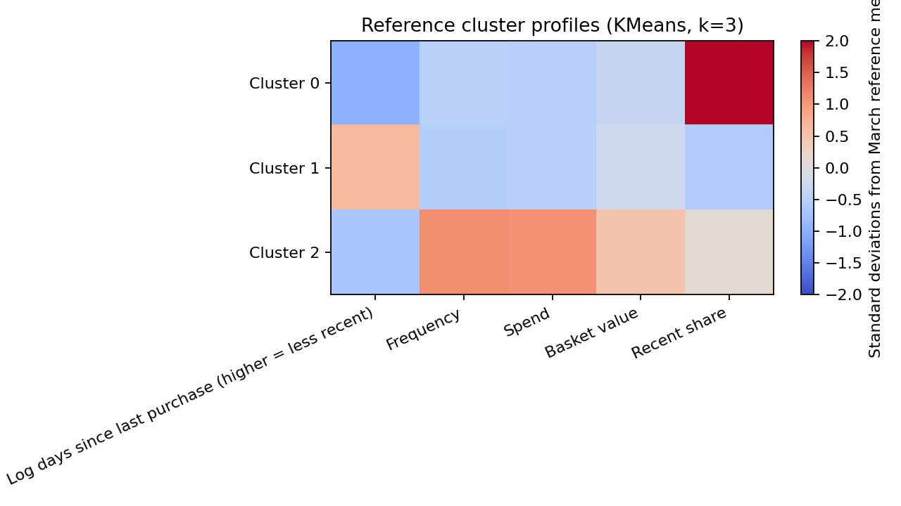
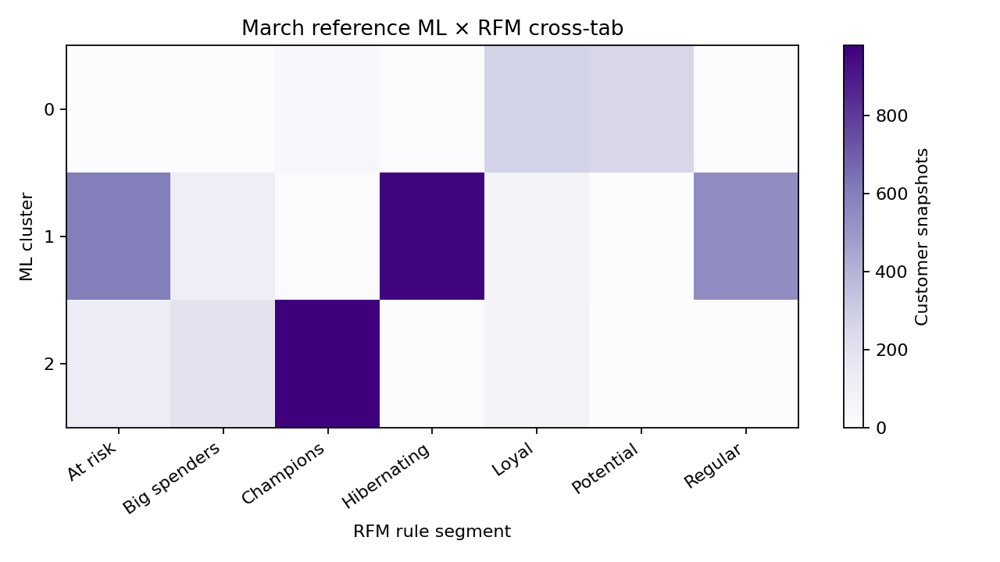
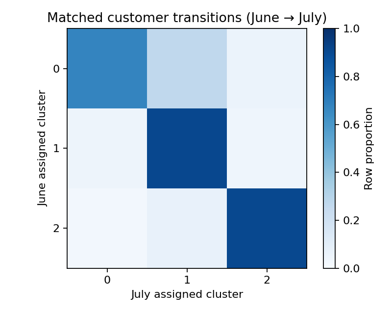

# P3-007 — Advanced Customer Segmentation

## Questions and cohort

This investigation compares transparent rule-based RFM groups with unsupervised clustering of historical customer behaviour. It asks whether clusters are reproducible, assignable to later snapshots, and useful as a compact behavioural summary. Segment membership is not a treatment and is not evidence of incremental CRM revenue.

The frozen M2-004 snapshot file contains 51,612 eligible customer-months from January–December 2011. We used the March 2011 snapshot (4,260 customers, one row per customer) as the sole reference fit period. January and February are before the reference period and are not evaluated as out-of-time assignments; December outcomes are not mature. The frozen March preprocessing, models and RFM thresholds were then applied without refitting to April–June development snapshots (12,961 rows, 4,552 distinct customers) and, separately, to the previously examined July–November period (21,672 rows, 4,999 customers). The latter is explicitly exploratory. Repeated customers across months are expected; month transitions use matched customer IDs and report entrants and leavers.

All clustering inputs are point-in-time M2 historical features available at each snapshot. No customer identifier, date, target, future outcome, propensity score or timing score entered clustering or model selection. Future purchase and value profiles were joined only after the unsupervised selection was complete. The join uses maturity-complete M2 labels and P3-006 private future-value/count outputs; row-level assignments and outcomes remain outside Git.

## Feature selection and reference-only preprocessing

The clustering feature set is RFM plus two compact behavioural summaries:

1. `days_since_last_qualifying_purchase` (recency)
2. `qualifying_purchase_occasions_365d` (frequency)
3. `qualifying_gross_merchandise_365d` (monetary)
4. `average_qualifying_basket_value_365d`
5. `purchase_occasion_share_90d = qualifying_purchase_occasions_90d / qualifying_purchase_occasions_365d`

The March reference Spearman audit found occasions365 vs distinct purchase dates365 correlation 0.98; occasions90 vs gross90 correlation 0.98; recency vs occasions90 correlation −0.84; occasions365 vs gross365 0.82; gross365 vs average basket value 0.68; and average basket value vs average basket quantity 0.83. We therefore kept occasion frequency rather than the redundant distinct-date count, omitted redundant 90-day gross and basket quantity, and used a bounded recent-activity share instead of an unadjusted recent count. Recency and recent share remain related by design and should not be interpreted as independent dimensions.

The four nonnegative raw features were transformed with `log1p`; the derived share was left on its 0–1 scale. Median imputation and standardization were fit only on the March reference rows and then held fixed. The selected features had no material missingness in March. No outcomes or later-month distributions informed preprocessing.

## RFM rule baseline

Recency, 365-day qualifying occasion count and gross merchandise were each assigned nominal ordinal scores from five reference-period quantile cutpoints using March thresholds. Recency scores are reversed (lower days since purchase scores higher); frequency and monetary scores increase with the measured value. Cutpoints are fixed and ties use deterministic `searchsorted(side="right")` assignment. Frequency has four non-empty score bands: single-occasion customers receive F=2 because the first quantile cutpoint is tied at one occasion. The log-scale cutpoints correspond approximately to:

| RFM dimension | March cutpoints on original scale |
|---|---|
| Recency (days) | 32.49, 90.49, 124.35, 190.39 |
| Frequency (occasions in 365d) | 1, 2, 3, 6 |
| Monetary (GBP gross in 365d) | £246.50, £489.60, £948.16, £2,040.80 |

Segments are assigned by fixed precedence: **Champions** (R≥4, F≥4, M≥4); **At risk** (R≤2, F≥3); **Hibernating** (R≤2, F≤2); **Loyal** (R≥4, F≥3); **Potential** (R≥4, F≤2); **Big spenders** (M≥4); otherwise **Regular**. This defines reproducible, overlapping RFM patterns without selecting thresholds from future outcomes. Eligibility already requires qualifying purchase activity in the 365-day window; there is no never-purchased group. Log transforms and quantile thresholds reduce the influence of the spending tail, but ties and skew still make segment sizes unequal.

## Clustering methods and selection

K-Means and full-covariance Gaussian Mixture Models were evaluated for k=3–8. K-Means used `n_init=20`, Lloyd updates and seeds 20261113, 20261114 and 20261115. GMM used `reg_covar=1e-5`, `n_init=5`, `max_iter=300` and the same seeds. Ward agglomerative clustering was fit for k=3–8 on the full 4,260-row reference cohort; it is computationally feasible at this size, but has no native out-of-sample assignment and is therefore a reference-only comparator. HDBSCAN was not installed and was not added: the fixed-assignment comparison is better supported by the available K-Means/GMM methods.

Silhouette was estimated on a deterministic 2,000-row sample; Davies–Bouldin, Calinski–Harabasz and cluster sizes used the full reference cohort. Seed stability is ARI against the first seed. Customer-bootstrap stability resampled March customer rows with replacement and predicted every original March row; 12 repetitions per K-Means/GMM k were run. This is a small perturbation audit, not a precise stability interval.

The selection rule was fixed before outcome profiling: require every reference cluster to contain at least 3% of customers, mean seed ARI ≥0.90 and mean customer-bootstrap ARI ≥0.75. Among qualifying candidates, choose the highest bootstrap ARI; use seed ARI, smaller k and K-Means as tie-breakers. Outcomes did not select the algorithm or k. **K-Means k=3 was selected** with silhouette 0.384, Davies–Bouldin 1.039, Calinski–Harabasz 2,169.6 and minimum cluster share 13.3%. The 12 bootstrap resamples were sufficient for this original selection check, but are relatively noisy for ranking runner-up models.

| Algorithm | k | Silhouette | Davies–Bouldin | Min cluster | Mean seed ARI | Bootstrap ARI mean (p10–p90) |
|---|---:|---:|---:|---:|---:|---:|
| K-Means | 3 | **0.384** | 1.039 | 13.3% | 0.993 | **0.974 (0.943–0.991)** |
| K-Means | 4 | 0.304 | 1.058 | 12.5% | 0.969 | 0.884 (0.826–0.975) |
| K-Means | 5 | 0.289 | 1.154 | 11.9% | 0.992 | 0.919 (0.839–0.978) |
| K-Means | 6 | 0.290 | 1.139 | 7.1% | 0.974 | 0.692 (0.535–0.923) |
| K-Means | 7 | 0.286 | 1.103 | 7.1% | 0.935 | 0.881 (0.843–0.933) |
| K-Means | 8 | 0.284 | 1.134 | 4.5% | 0.980 | 0.716 (0.602–0.927) |
| GMM | 3 | 0.163 | 1.413 | 16.8% | 0.572 | 0.651 (0.554–0.972) |
| GMM | 4 | 0.281 | 1.435 | 10.7% | 1.000 | 0.868 (0.642–1.000) |
| GMM | 5 | 0.231 | 1.417 | 7.0% | 0.901 | 0.788 (0.709–0.947) |
| GMM | 6 | 0.195 | 1.622 | 6.9% | 0.995 | 0.796 (0.574–0.990) |
| GMM | 7 | 0.194 | 1.508 | 0.2% | 0.888 | 0.735 (0.555–0.871) |
| GMM | 8 | 0.144 | 1.940 | 5.6% | 0.880 | 0.896 (0.807–0.965) |

Ward agglomerative silhouette ranged 0.223–0.369 and Davies–Bouldin 1.027–1.175 for k=3–8; k=3 gave 0.369 and 1.057. It yielded viable reference partitions but cannot be applied consistently to later observations without defining an additional assignment approximation, so it was not used for temporal comparisons. Internal indices are geometric criteria, not proof of commercial usefulness.

## Reference segment profiles and RFM comparison

| K-Means segment | Reference n / share | Median recency (days) | Median occasions365 | Median gross365 (£) | Median basket (£) | Median recent share |
|---|---:|---:|---:|---:|---:|---:|
| Cluster 0 | 567 / 13.3% | 31.4 | 2 | 410.23 | 220.10 | 1.00 |
| Cluster 1 | 2,310 / 54.2% | 150.4 | 1 | 388.64 | 245.77 | 0.00 |
| Cluster 2 | 1,383 / 32.5% | 42.5 | 6 | 2,438.84 | 368.78 | 0.20 |

These are behavioural descriptions, not customer value labels: cluster 0 is recently active with low-to-moderate historical frequency; cluster 1 is predominantly inactive and single-occasion; cluster 2 is frequent and high-spend. The labels 0/1/2 are fixed model IDs, not ordered scores.

RFM segments and the K-Means partition are not equivalent. In March their adjusted Rand index (ARI) is 0.357 and normalized mutual information (NMI) is 0.493; across April–November, ARI ranges 0.414–0.495 and NMI 0.534–0.577. ARI and NMI measure agreement between segmentations, not commercial quality. Cluster 1 spans mostly Hibernating, At risk and Regular RFM customers; cluster 2 is mostly Champions; cluster 0 is split mostly across Loyal and Potential. The three clusters provide a compact, stable behavioural summary. Within some coarse RFM segments they separate customers by historical frequency and spending, dimensions already represented in the full RFM scores; this does not establish a new recent-activity distinction or meaningful incremental purchase discrimination beyond RFM.

## Frozen assignments and temporal stability

The selected March K-Means model and its March-fitted transformations assign later months with `predict`; no evaluation snapshot is used to refit centroids, scaling or imputation. Reference cluster membership is stable to initialization (mean seed ARI 0.993) and customer resampling (mean ARI 0.974; 12 replicates). This measures partition procedure stability on the reference population.

| Month | Cluster 0 | Cluster 1 | Cluster 2 |
|---|---:|---:|---:|
| March reference | 13.3% | 54.2% | 32.5% |
| April | 15.4% | 54.0% | 30.6% |
| May | 17.5% | 52.3% | 30.2% |
| June | 18.2% | 51.3% | 30.5% |
| July* | 18.2% | 51.0% | 30.8% |
| August* | 18.6% | 51.1% | 30.3% |
| September* | 16.9% | 53.0% | 30.2% |
| October* | 20.5% | 48.6% | 30.9% |
| November* | 26.8% | 42.1% | 31.1% |

*July–November composition is exploratory. Cluster 0 grows from 13.3% in March to 26.8% in November, while cluster 1 contracts from 54.2% to 42.1%; cluster 2 remains near 30–33%. Within cluster 1, median recency increases from 150 days in March to 205 days in June and 221 days in November. This pattern is consistent with observed activity changing under fixed boundaries, but also reflects changing eligible-customer composition. It is not by itself evidence that the clustering procedure became unstable or that a population-level concept drift test has been passed.

For transitions, only customers eligible in both adjacent months are compared. The “same segment” share is direct persistence under the fixed numeric cluster IDs; ARI summarizes the whole transition matrix. Entrants/leavers are customers appearing in only one of the two snapshots.

| From → to | Matched | Entrants / leavers | ML same segment | ML ARI | RFM same segment | RFM ARI |
|---|---:|---:|---:|---:|---:|---:|
| Mar → Apr | 4,132 | 186 / 128 | 85.9% | 0.620 | 64.6% | 0.512 |
| Apr → May | 4,205 | 114 / 113 | 88.8% | 0.692 | 75.3% | 0.630 |
| May → Jun | 4,197 | 127 / 122 | 87.1% | 0.653 | 78.0% | 0.666 |
| Jun → Jul* | 4,192 | 122 / 132 | 86.2% | 0.636 | 76.0% | 0.646 |
| Jul → Aug* | 4,208 | 118 / 106 | 86.3% | 0.645 | 77.4% | 0.662 |
| Aug → Sep* | 4,204 | 120 / 122 | 86.8% | 0.656 | 76.5% | 0.669 |
| Sep → Oct* | 4,148 | 216 / 176 | 84.8% | 0.600 | 72.6% | 0.595 |
| Oct → Nov* | 4,063 | 281 / 301 | 82.9% | 0.563 | 70.6% | 0.554 |

K-Means persistence is reasonably high, but is not demonstrably superior to RFM. K-Means has three categories while RFM has seven, so raw same-segment shares are not directly comparable without accounting for chance agreement. Chance-corrected ARI results are mixed, and RFM ARI is equal or higher in four of eight transitions. Examples are April–May (K-Means 0.692, RFM 0.630), May–June (0.653, 0.666), and October–November (0.563, 0.554). Consecutive monthly snapshots also use overlapping 365-day history windows: approximately 11 of 12 months are shared between adjacent snapshots. High month-to-month persistence is therefore partly expected mechanically and does not independently demonstrate future generalisation. This temporal comparison is distinct from the March-only customer-bootstrap stability result. Entrants and leavers are excluded from matched transition metrics.

## Mature future-outcome profiles

Outcomes below are descriptive and were inspected only after choosing K-Means k=3. April–June contains 12,961 mature customer-month labels; July–November contains 21,672 mature rows from the previously examined holdout period and is exploratory. Values are nominal qualifying gross GBP, not margin or net revenue. Repeated rows mean snapshots are not independent; no row-level significance test or causal claim is made.

| April–June segment | Snapshots | Next-30d purchase rate | Mean gross value (£) | Mean next-30d occasions |
|---|---:|---:|---:|---:|
| K-Means cluster 0 | 2,211 | 17.9% | 68.40 | 0.238 |
| K-Means cluster 1 | 6,810 | 8.3% | 27.48 | 0.091 |
| K-Means cluster 2 | 3,940 | 39.2% | 313.06 | 0.627 |
| RFM Champions | 3,144 | 44.0% | 357.38 | 0.738 |
| RFM Hibernating | 3,351 | 5.2% | 19.57 | 0.058 |
| RFM At risk | 2,976 | 12.1% | 52.78 | 0.134 |
| RFM Big spenders | 419 | 27.9% | 151.30 | 0.329 |

ML cluster outcomes are well ordered, but the RFM rule extremes are at least as stark: Champions exceed K-Means cluster 2 on purchase rate and mean value, while Hibernating is below cluster 1. Among RFM groups with at least two ML-cluster cells of n≥50, the median within-RFM purchase-rate range is 8.6 percentage points and the median mean-value range is £118 per snapshot. This describes within-group variation; the dimensions are already represented in full RFM scores and do not demonstrate incremental purchase discrimination.

An independent reviewer-derived diagnostic, not used in the original model selection, scored April–June snapshots using purchase rates estimated from March-defined groups. April–June ROC-AUC was:

| Grouping | April–June ROC-AUC |
|---|---:|
| Seven RFM segments | 0.748 |
| Three K-Means clusters | 0.721 |
| RFM segments × clusters | 0.751 |
| Full RFM score code | 0.753 |
| RFM score code × clusters | 0.751 |

These descriptive diagnostics do not show meaningful incremental purchase discrimination from clusters. They are not evidence of incremental campaign revenue or causal effects, and April–June is not an untouched independent test set.

On the exploratory July–November replay, K-Means cluster purchase rates / mean values were: cluster 0, 22.6% / £83.45; cluster 1, 10.8% / £41.86; cluster 2, 44.5% / £450.51. RFM Champions were 48.5% / £496.63, Hibernating 7.1% / £31.66 and Big spenders 32.8% / £238.53. The same ordering persists, but this period has already influenced previous research and is not independent validation.

No propensity, survival or monetary model score was used to form clusters. Neither a high purchase rate nor high spend in a segment estimates the effect of targeting that segment.

## Runtime, artifacts and limits

The experiment used 186 estimator fits: 18 K-Means seed fits, 18 GMM seed fits, 144 customer-bootstrap fits and six Ward fits. Runtime was 29.07 seconds inside the runner and 30.89 seconds wall for the full command. macOS `/usr/bin/time -l` reported 482,148,352 bytes maximum resident set size and 401,425,464 bytes peak memory footprint; these are separate tool measurements. Environment: Python 3.11.14, NumPy 2.4.4, pandas 3.0.2, SciPy 1.17.1 and scikit-learn 1.8.0.

Nine focused tests pass for feature construction, reference-only preprocessing, frozen assignment, deterministic fitting and label alignment, repeated-customer transitions, cluster metrics and 30-day target filtering. Customer-month assignments and aggregate results/manifest are under `source_data/uci_online_retail_ii/p3_007_outputs/` outside Git. Four aggregate-safe figures are saved in `docs/research/figures/`; rerunning overwrites these P3-007 figures. No frozen M1/M2 or prior P3 outputs were modified.

The March-only reference is short and may not capture seasonality. Stability bootstrap has only 12 replicates. Repeated customers, entrants/leavers, overlapping monthly windows, changes in eligibility, heavy-tailed spend and prior holdout examination limit inference. Internal cluster scores are not commercial utility. Future outcome differences are descriptive, not causal; no campaign incremental effect or independent future confirmation is available. The RFM baseline remains easier to explain, and the selected K-Means partition is best treated as an exploratory analytical view rather than an operational replacement.

## Recommendation

Retain the fixed, transparent RFM rules as the primary CRM-facing segmentation framework. Keep the selected three-cluster K-Means solution as an optional exploratory visualisation: it provides a compact behavioural summary, is stable under seeds and customer resampling, and can be assigned to later snapshots without refit. Available evidence does not demonstrate meaningful incremental purchase discrimination beyond RFM. Do not add clusters to propensity models or infer campaign effects from these observational differences. Reassess on a genuinely later period and test incremental campaign response before operational adoption.

## Reproduction artifacts

- Runner and tests: `src/monthly_customer_segmentation.py`, `tests/test_monthly_customer_segmentation.py`.
- Private customer-month assignments and aggregate JSON/manifest: `../source_data/uci_online_retail_ii/p3_007_outputs/`.
- Figures: `figures/p3_007_cluster_feature_profiles.png`, `figures/p3_007_segment_sizes.png`, `figures/p3_007_june_july_transition.png`, `figures/p3_007_rfm_cluster_crosstab.png`.
- Research definitions: [M2 baseline protocol](COMMERCIAL_DS_P2_M2_007_BASELINE_PROTOCOL.md), [P3-002 benchmark](COMMERCIAL_DS_P3_002_ADVANCED_ML_BENCHMARK.md), [P3-003 booster extension](COMMERCIAL_DS_P3_003_XGBOOST_LIGHTGBM_BENCHMARK.md), [P3-004 SHAP](COMMERCIAL_DS_P3_004_SHAP_EXPLAINABILITY.md), [P3-005 calibration](COMMERCIAL_DS_P3_005_CALIBRATION_UNCERTAINTY.md), [P3-006 value and timing](COMMERCIAL_DS_P3_006_FUTURE_VALUE_AND_PURCHASE_TIMING.md).
