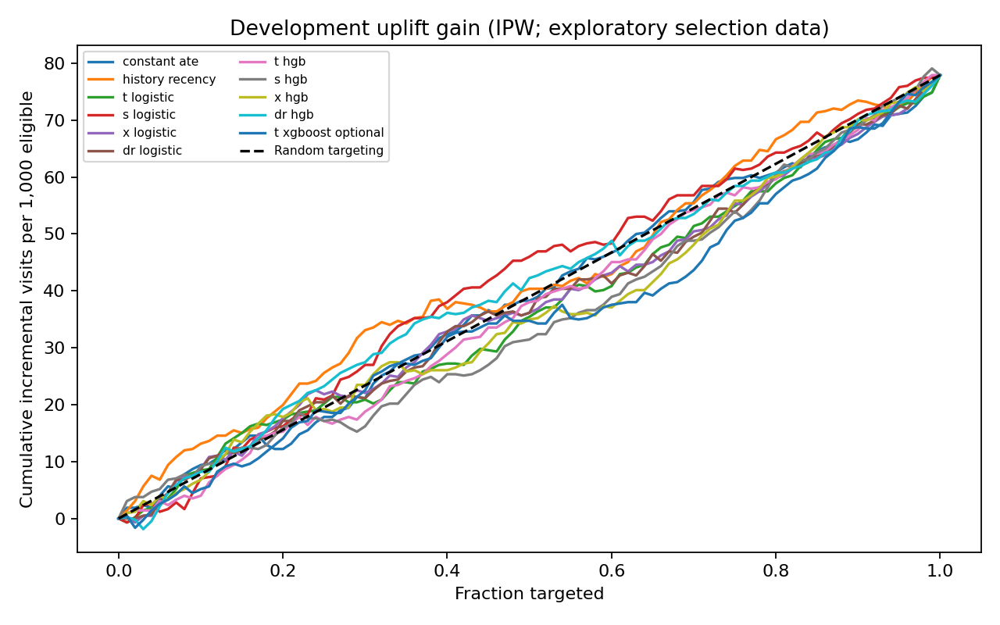
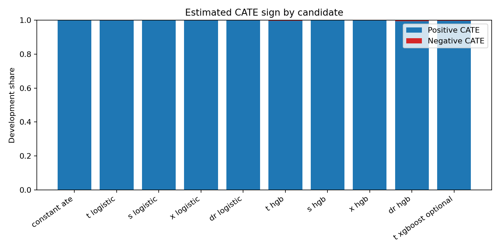
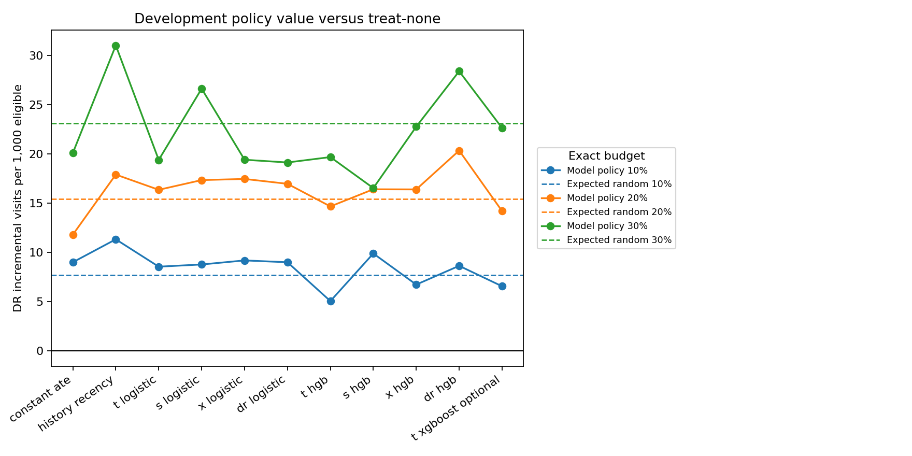

# P3-008B — Causal ML and Uplift Modelling

## Research question and scope

This experiment estimates heterogeneous effects of assignment to the Men's email versus no email on website visits during the two-week outcome period. The estimand is intention-to-treat assignment, not email delivery, opening, or reading. CATE scores are model predictions, not observed individual effects. Women's-email observations were excluded from this primary binary contrast and remain for a later separate analysis.

P3-008B uses the frozen P3-008A source CSV (SHA-256 `0e5893329d8b93cefecc571777672028290ab69865718020c78c7284f291aece`) and row split (SHA-256 `0f18d512272cee14da65940cb52a9458eb35e357489e745339ac88cd9a9a00ce`). The runner parses the 51,200 training/development rows only and skips all 12,800 test rows before reading their outcome values. No test outcome, model score, ATE, uplift curve, or policy value was accessed or calculated. The locked test evaluation is reserved for P3-008C after the policy is frozen.

The primary causal assumptions remain those of P3-008A: randomized assignment implemented as documented, consistency, positivity, complete outcome observation, and no material customer-to-customer interference. The released file has no customer ID; row-level bootstrap and split units follow the documented one-customer-per-row design. Some identical rows cross splits, so exact identity overlap cannot be verified.

## Modeling population and data handling

| Partition | Men's email (`T=1`) | No email (`T=0`) | Pairwise total | Visit events |
|---|---:|---:|---:|---:|
| Training | 12,784 | 12,784 | 25,568 | 3,648 |
| Development | 4,261 | 4,261 | 8,522 | 1,252 |
| Locked test | not loaded | not loaded | not loaded | not accessed |

The realized propensity convention is `e = n_M/(n_M+n_0)` within each split. It is 0.500 in both training and development. The test split's realized propensity was not computed in this milestone. We used exactly the eight P3-008A pre-treatment features: `recency`, `history`, `mens`, `womens`, `newbie`, `history_segment`, `zip_code`, and `channel`. `visit`, `conversion`, `spend`, row index, split membership, and assignment are excluded from ordinary feature inputs; assignment enters only the S-learner treatment input. The raw category spelling is preserved.

Each estimator's imputer and encoder were fit on its training rows only. Logistic models use median numeric imputation and standardization, most-frequent categorical imputation and dense one-hot encoding. HGB/XGBoost use median numeric imputation, most-frequent imputation and dense one-hot encoding; numeric scaling is unnecessary for trees. DR nuisance preprocessing is refit within each training cross-fit. Evaluation probabilities were the positive-class probabilities and remained within `[0,1]`; no probability clipping was needed. CATE and DR pseudo-outcome predictions were not clipped.

## Learners and fixed configurations

| Candidate | Method and configuration |
|---|---|
| Constant ATE | Training randomized difference in visit rates; one constant CATE for all rows; seeded random tie priority gives exact-budget random targeting. |
| Historical behavior | Rank higher `history`, then lower `recency`; seeded tie priority. A targeting benchmark only, not a CATE estimator. |
| Logistic T-learner | Separate L2 logistic outcome models, `C=1`, `lbfgs`, max 1,000 iterations; CATE `p1−p0`. |
| Logistic S-learner | One logistic model with the explicit binary treatment input; predict both counterfactual states and subtract positive-class probabilities. |
| Logistic X-learner | Logistic initial outcome models; treated pseudo-effect `Y−m0(X)`, control pseudo-effect `m1(X)−Y`; Ridge `alpha=1` effect regressions and the fixed propensity combination. |
| Logistic DR-learner | Five-fold stratified cross-fit logistic nuisance models; DR pseudo-outcome; Ridge `alpha=1` final CATE regression. |
| HGB T/S/X/DR | Same four learner structures. HGB config: learning rate .05, 7 leaves, 100 iterations, minimum leaf 50, L2=1, `early_stopping=False`, seed 20261114. HGB X/DR effect regressions use the corresponding bounded HGB regressor. |
| Supplementary XGBoost T-learner | One CPU histogram config: 100 trees, depth 3, learning rate .05, minimum child weight 10, row/column subsampling .8, L1=0, L2=1, one thread, seed 20261114. It was fitted in the initial run, but P3-008A deferred XGBoost from formal comparison; its results are now explicitly supplementary and it is excluded from promotion. |

**Protocol correction:** the first P3-008B implementation appended XGBoost to the formal selection order, despite P3-008A explicitly deferring it. This correction removes XGBoost from promotion while retaining its original fitted development predictions and descriptive results. No model was retrained and no configuration or outcome was changed.

The X-learner uses `e × tau_control + (1−e) × tau_treated`, where `tau_treated=Y−m0(X)` and `tau_control=m1(X)−Y`. For DR, each training observation's pseudo-outcome is

`ψ = m1(X)−m0(X) + T/e × (Y−m1(X)) − (1−T)/(1−e) × (Y−m0(X))`.

Both five-fold DR candidates use training-only, out-of-fold `m0` and `m1` predictions; each fold nuisance fit excludes the held-out training rows. Cross-fit fit-fold sizes were 20,454–20,455 of the 25,568 pairwise training rows. DR pseudo-outcomes ranged approximately −1.91 to +1.91; these are not probabilities and were not clipped. The separate DR policy-value evaluator uses the same logistic T-learner nuisance models fit on training only for every candidate, giving like-for-like development policy estimates.

There were **44 estimator fit calls**: 22 logistic-related, 20 HGB-related, and 2 XGBoost outcome models. Development predictions were made for 8,522 observations. Seeds are 20261114 for estimators, 20261116 for tie priority, and 20261115 for the 1,000 paired bootstrap replicates. All estimators use one CPU thread where applicable.

## Development estimates and policy evaluation

The training-arm visit rates were 17.99% for Men's email and 10.54% for control, giving a training difference of **+7.45 percentage points** and the constant-effect baseline. Development rates were 18.59% and 10.80%, a **+7.79 pp development-only** difference; it is part of candidate evaluation, not confirmation.

For each score, candidates jointly ranked the 8,522 development rows in the pairwise population. At budgets of 10%, 20%, and 30%, policies treat exactly `ceil(q × n)` rows (853, 1,705, and 2,557). Negative predicted CATE scores do not cause a fixed-budget policy to underspend; treat-none is a separate benchmark. The same development realized propensity (0.500) is used for all candidates.

Qini gains use the **Horvitz–Thompson known-propensity** treatment-control difference among the top-ranked selected rows, multiplied by the selected count and scaled to incremental visits per 1,000 pairwise-eligible observations. The random-targeting reference is the development full-population IPW ATE times the selected fraction. AUUC is the trapezoidal area above that random reference over fractions 0–1, in incremental visits per 1,000; it is not divided by the ATE. Policy values map `X` to email/no email and are evaluated by both IPW and DR. The DR policy value is `mean[m̂π(X)(X) + I(A=π(X))/p(A|split) × (Y−m̂A(X))]`; incremental value subtracts treat-none. DR nuisance predictions for development are from models fit only on training. Bootstrap comparisons resample the same development rows for both policies and recompute exact-budget ranks.

The table below is a **descriptive development leaderboard**. It separates ordinary treated-outcome prediction, CATE score summaries/ranking, and treatment-policy values; none is interchangeable with another.

| Policy score | Estimated CATE mean | Negative CATE share | CATE vs `m1` Spearman | AUUC / 1,000 | IPW uplift at 10 / 20 / 30% | DR increment vs none at 20% |
|---|---:|---:|---:|---:|---:|---:|
| Constant ATE / random tie | 7.45 pp | 0.00% | N/A (constant) | −0.33 | 9.39 / 12.20 / 21.12 | 11.81 |
| Historical spend then recency | N/A | N/A | N/A; not a CATE | 2.96 | 13.14 / 19.95 / 33.09 | 17.91 |
| Logistic T | 7.42 pp | 0.22% | 0.619 | −2.17 | 8.45 / 17.37 / 20.89 | 16.36 |
| Logistic S | 7.47 pp | 0.00% | 1.000 | 2.53 | 7.04 / 16.19 / 26.99 | 17.35 |
| Logistic X | 7.44 pp | 0.20% | 0.664 | −1.41 | 8.68 / 17.60 / 22.06 | 17.47 |
| Logistic DR | 7.43 pp | 0.26% | 0.650 | −1.49 | 8.68 / 17.13 / 21.12 | 16.97 |
| HGB T | 7.47 pp | 0.45% | 0.515 | −1.77 | 3.99 / 15.25 / 18.77 | 14.67 |
| HGB S | 6.83 pp | 0.00% | 0.672 | −3.48 | 9.15 / 15.96 / 16.19 | 16.42 |
| HGB X | 7.45 pp | 0.09% | 0.579 | −2.40 | 6.81 / 17.84 / 23.47 | 16.40 |
| HGB DR | 7.43 pp | 0.55% | 0.517 | 0.99 | 8.21 / 19.24 / 27.46 | 20.35 |
| XGBoost T | 7.44 pp | 0.42% | 0.535 | −3.63 | 5.16 / 14.08 / 22.53 | 14.20 |

The IPW uplift columns are cumulative incremental visits per 1,000 eligible rows at each fixed budget; DR values are likewise incremental visits per 1,000 eligible rows versus treat-none. For context, the 20% constant policy's single seeded tie-break draw had DR value 11.81 per 1,000, compared with expected random targeting at **15.42** per 1,000. The expected reference is `q ×` the full-population DR ATE: the estimated DR ATE is 77.11 visits per 1,000. The original seeded draw is retained as the literal frozen-protocol result; the independent review's random-targeting reference simulation placed it at approximately the **12.7th percentile**. The expected-random benchmark is more representative of repeated random targeting. The development treat-none estimate was 108.36 per 1,000 by DR. These are development estimates, not test results.

## Uncertainty-aware model selection

Primary model selection follows the frozen P3-008A complexity order: constant ATE, logistic T/S/X/DR, then HGB T/S/X/DR. XGBoost is supplementary and is not eligible for promotion. The historical behavior score is evaluated separately as a targeting benchmark and is not part of the learner promotion sequence. At 20% budget, a candidate replaces the current simpler learner only if the lower end of its paired 95% customer-row bootstrap interval for DR incremental policy value is above zero. The original seeded-random comparisons below are retained unchanged for protocol transparency. These intervals condition on the fitted models and nuisance predictions and are not multiplicity-adjusted across the model comparisons; they do not establish future-period performance.

| Candidate vs current simpler incumbent | ΔDR policy value / 1,000 | Paired 95% interval | Promoted? |
|---|---:|---:|---|
| Logistic T vs constant | +4.55 | [−4.60, +13.17] | No |
| Logistic S vs constant | +5.54 | [−4.04, +13.81] | No |
| Logistic X vs constant | +5.66 | [−3.45, +14.46] | No |
| Logistic DR vs constant | +5.16 | [−4.46, +13.72] | No |
| HGB T vs constant | +2.86 | [−6.45, +11.53] | No |
| HGB S vs constant | +4.61 | [−4.77, +12.84] | No |
| HGB X vs constant | +4.59 | [−4.91, +12.70] | No |
| HGB DR vs constant | +8.54 | [−1.50, +16.29] | No |
Separately, historical behavior versus constant ATE had a paired ΔDR policy value of **+6.10 visits per 1,000** with 95% interval **[−2.95, +14.30]**. This benchmark comparison does not enter model selection.

The XGBoost T supplementary comparison against the seeded constant policy was +2.39 visits per 1,000 [−6.95, +10.22]; it is descriptive only and was not part of selection.

### Expected-random targeting comparison

The paired bootstrap reference in this table is recomputed in every resample as `q ×` that resample's DR ATE. Nuisance predictions remain the shared models fitted on training only.

| Score policy vs expected random at 20% | ΔDR visits / 1,000 | Paired 95% interval | Formal learner? |
|---|---:|---:|---|
| Seeded constant-ATE draw | −3.61 | [−9.04, +2.87] | No; protocol reference |
| Historical behavior | +2.49 | [−3.45, +9.00] | No; baseline |
| Logistic T | +0.94 | [−5.37, +7.85] | Yes |
| Logistic S | +1.93 | [−4.66, +8.37] | Yes |
| Logistic X | +2.05 | [−4.61, +8.74] | Yes |
| Logistic DR | +1.55 | [−5.24, +7.95] | Yes |
| HGB T | −0.75 | [−6.85, +6.38] | Yes |
| HGB S | +1.00 | [−5.63, +7.44] | Yes |
| HGB X | +0.98 | [−5.73, +7.19] | Yes |
| HGB DR | +4.93 | [−2.34, +11.27] | Yes |
| XGBoost T | −1.22 | [−7.48, +5.55] | No; supplementary |

The independently specified point references reproduce: seeded random 11.81; expected random 15.42; HGB DR +4.93; logistic X +2.05; logistic T +0.94; and historical behavior +2.49. Recomputed percentile endpoints are shown in the table; they differ by at most 0.01 from the review's rounded interval values. Both comparison conventions leave the selected policy at constant ATE; no advanced learner has a statistically distinguishable targeting benefit. This null promotion does not establish homogeneous effects.

## Heterogeneity and ranking diagnostics

The fitted learner CATE means ranged from 6.83 to 7.47 percentage points. Most estimated scores were positive, with negative shares from 0% to 0.55%; no method found a sizable negative-effect region. These fitted distributions should not be read as observed customer-level causal truths. CATE versus predicted treated-outcome propensity rank correlation ranged from 0.515 to 1.000. Logistic S was almost perfectly rank-aligned with `m1` (ρ≈1) because its additive logistic treatment effect is monotone in the baseline outcome score; its ranking is therefore not independent evidence of personalization beyond propensity.

Across the 36 pairwise CATE-model comparisons, Spearman rank agreement ranged 0.328–0.998 (median 0.629), and top-20% customer-set Jaccard overlap ranged 0.290–0.956 (median 0.405). Logistic X and logistic DR rankings were nearly identical (ρ=0.998; Jaccard 0.956), while logistic and HGB T-learner rankings agreed less (ρ=0.581; Jaccard 0.379). Ranking instability across methods, together with wide policy intervals, cautions against treating a visually distinct CATE distribution as reliable targeting heterogeneity.

AUUC estimates were small and mixed around zero. The historical score and logistic S had positive areas (+2.96 and +2.53 incremental visits per 1,000); HGB DR was +0.99, while other nonlinear/linear learners were negative. This variation does not establish a repeatable ranking advantage. Model-specific Qini curves, CATE sign summaries, and policy-value estimates are shown below.

## Reproducibility and limitations

Two clean development runs reproduced the original aggregate model metrics, Qini/AUUC values, rank agreements, paired intervals, selection decision, and private prediction Parquet SHA-256 exactly. The expected-random correction was then recalculated from those saved development predictions with **zero estimator fits**. The prediction Parquet SHA-256 remained `986a88b48c0b062d6fc8a65b0bf8f21efb5d2750d43747af68246dd09b10dae3`. Original model-run runtimes were 17.30 and 17.95 seconds; peak RSS was 287,195,136 and 284,000,256 bytes. Environment: Python 3.11.14, NumPy 2.4.4, pandas 3.0.2, SciPy 1.17.1, scikit-learn 1.8.0, XGBoost 3.2.0. The original runner used 44 estimator fit calls. The raw dataset, frozen split, aggregate JSON, and row-level development predictions are under `source_data/hillstrom/` outside Git; only aggregate-safe figures and this report are repository deliverables.

This is one historical randomized experiment. Conversion/spend analyses and the Women's arm were not modeled here. The test split remains unexamined, but published Hillstrom results are widely available, so its lock prevents direct reuse in selection rather than creating genuine analyst blinding. All bootstrap intervals condition on fitted models and nuisance predictions; they are not multiplicity-adjusted across model comparisons and do not account for model-selection uncertainty or future-period variation. Row-level bootstrap follows the available customer-row unit; no customer identifier exists to resolve identical records that cross splits. Policy values assume no contact cost and cannot be interpreted as profit or ROI. Effects may not transport to current campaigns or the UCI retail customer population. The raw data, split, aggregate JSON and row-level predictions remain outside Git; the runner, focused tests, this report and aggregate-safe figures are the repository deliverables.

## Selected policy and P3-008C specification

## Selected policy and frozen P3-008C specification

Retain **constant ATE / expected random targeting**, with the single seeded tie-break result shown only for protocol transparency. The formal model order and configurations are frozen above; XGBoost remains supplementary.

P3-008C will:

1. Verify the frozen source and split checksums and use only Men's-email and no-email rows from the locked test split for the primary contrast.
2. Estimate the primary confirmatory effect on two-week website visits by the randomized difference in means (risk difference), with the predeclared two-sided randomization test and 95% Newcombe/Wilson risk-difference interval described in P3-008A. Report arm counts and rates, then the ATE, interval, and test result.
3. Evaluate the selected 20% constant-ATE policy against treat-none using **expected random-targeting incremental value = 0.20 × the test-split ATE**. This is the primary policy-value summary; do not use one seeded random draw as the primary result. A seeded draw may appear as a secondary illustration.
4. Preserve the frozen pairwise eligible population, exact budget convention (`ceil(0.20 × n)` if a realized exact-budget ranking is illustrated), and realized treated-arm propensity convention for IPW/DR calculations. No email cost or profit estimate is available.
5. Treat any candidate-model test policy values as secondary exploratory diagnostics only. If generated, use only the frozen configurations, train nuisance models on train plus development, produce candidate scores once, and use paired uncertainty. Do not tune, calibrate, change the ranking rule, or select a new winner from test outcomes. Candidate test comparisons do not replace the confirmatory ATE.

No test outcomes were accessed during this correction milestone. The locked P3-008C evaluation has not been run.
